# SILLYCONE ⚡
### *The Living Silicon Knowledge Graph & Spec Observatory*

[](https://nextjs.org/)
[](https://reactflow.dev/)
[](https://supabase.com/)
[](https://github.com/features/actions)
[](https://github.com/Tribal-Chief-001/Sillycone)
[](LICENSE)

```
┌────────────────────────────────────────────────────────────────────────────────────────────────────────┐
│ SILLYCONE SYSTEM TELEMETRY HUD                                            SYS.STAT: 24/7 RADAR ONLINE  │
├─────────────────┬───────────────────────────────────┬──────────────────────────────────┬───────────────┤
│ [FND] TSMC N3P  │ [PKG] InFO-PoP 2.5D               │ [UARCH] Oryon Gen 2 Phoenix L    │ CONF: 100%    │
│ 224.0 MTr/mm²   │ 128-bit LPDDR5X-9600              │ 2P @ 4.32GHz + 6M @ 3.53GHz      │ RET: VERIFIED │
└─────────────────┴───────────────────────────────────┴──────────────────────────────────┴───────────────┘
```

> **Sillycone** is an open-source, high-density **Bloomberg Terminal for Semiconductors**. It unifies mobile SoCs (Qualcomm Snapdragon, MediaTek Dimensity, Apple A-series, Xiaomi in-house silicon), laptop APUs, desktop CPUs, and discrete GPUs into a 6-tier deterministic Directed Acyclic Graph (DAG) with cross-platform Perf/Watt efficiency curves, autonomous 24/7 benchmark crawlers, and mathematical rumor-to-silicon accountability tracking.
>
> **Engineered to operate 100% Free ($0/month) with zero laptop tethering.**

---

## 🌟 The Problem: Why Current Tech Media Fails Hardware Geeks

1. **Information Trapped in Ephemeral News Cycles:** Leaks drop on Weibo, Chiphell, or X; within weeks, they are buried under clickbait articles. When chips launch, nobody calculates the delta against original claims.
2. **Databases Are Flat & Backwards-Looking:** TechPowerUp and CPU-World are gold standards for released specs, but they are rigid relational tables incapable of modeling probabilistic unreleased silicon.
3. **Hardware is a Dependency Tree:** A chip does not exist in a vacuum. A GPU or SoC depends on a lithographic foundry node (TSMC N3P, Intel 18A), advanced packaging (InFO, CoWoS, Foveros), microarchitecture IP, and memory interconnects.
4. **Cross-Platform Incomparability:** Marketing compares a 5W smartphone SoC to a 125W desktop processor with deceptive peak single-core numbers, ignoring thermal dissipation and dynamic voltage-frequency curves.

---

## 📐 High-Level Architecture & Intelligence Pipeline

```mermaid
flowchart TD
    subgraph SOURCES["1. Autonomous Multi-Tier Ingestion (24/7 Cloud Cron)"]
        S1["Linux Kernel (LKML, drm-next, Mesa)"]
        S2["LLVM / Clang Target Triples & Schedulers"]
        S3["EEC Filings & Zauba/NBD Customs Manifests"]
        S4["Geekbench 6/7 & 3DMark Browser Submissions"]
        S5["Weibo Insiders (DCS, Fixed Focus) & X Leakers"]
    end

    subgraph ENGINE["2. Resolution & Normalization Engine ($0/mo)"]
        E1["GitHub Actions Serverless Cron (0 */6 * * *)"]
        E2["Entity Resolution & Topology Parser"]
        E3["Bayesian Confidence Calculus (Log-Normal CI95%)"]
        E4["Dynamic V/F Efficiency Modeling (P = C·V²·f + Pleak)"]
        E5["Leaker Accountability Scoring (WMAPE + Brier)"]
    end

    subgraph STORAGE["3. PostgreSQL / Supabase Hybrid DB"]
        D1[("foundry_nodes (Tier 0)")]
        D2[("packaging_substrates (Tier 1)")]
        D3[("microarchitectures (Tier 2)")]
        D4[("chips & topologies (Tier 3-5)")]
        D5[("benchmarks & leak_deltas")]
    end

    subgraph UI["4. Avant-Garde Telemetry Terminal (Next.js 14)"]
        U1["Interactive 6-Tier React Flow DAG Canvas"]
        U2["High-Density Spec Observatory Table"]
        U3["Dynamic V/F Efficiency Curve Explorer"]
        U4["Rumor-to-Silicon Delta & Leaker Leaderboard"]
        U5["Bloomberg / Vim Hotkey Matrix & Command Palette"]
    end

    SOURCES --> ENGINE
    ENGINE --> STORAGE
    STORAGE --> UI
```



---

## ⚡ Core Systems & Features

### 1. 🧬 Interactive 6-Tier DAG Canvas
* Visualizes the complete lithographic hierarchy:
  $$\text{Tier 0 (Foundry Node)} \longrightarrow \text{Tier 1 (Packaging Substrate)} \longrightarrow \text{Tier 2 (Microarchitecture)} \longrightarrow \text{Tier 3 (Silicon Die/SKU)}$$
* Powered by `@xyflow/react` with animated electron-flow connector edges, transistor density meters, and instant slide-out deep telemetry inspection drawers.

### 2. 📊 High-Density Spec Observatory Table
* Real-time search by entity name, vendor, codename, or microarchitecture family.
* Segment isolation: Mobile SoCs, Handheld APUs, Thin & Light Laptops, Desktop CPUs, Discrete GPUs.
* Sortable metrics: cTDP envelope, Geekbench 6 Single/Multi, Memory Bandwidth (GB/s), and Bayesian Confidence Score.

### 3. ⚡ Cross-Platform V/F & Efficiency Curve Simulator
* Solves the 5W vs 250W comparison dilemma using dynamic voltage-frequency power modeling:
  $$P(f) = C \cdot V(f)^2 \cdot f + P_{\text{leak}}$$
* Move the interactive power slider from **4W to 125W** to simulate who actually delivers the highest compute density at any given wattage constraint.

### 4. 🎯 Rumor-to-Silicon Delta Tracker & Leaker Scoreboard
* Measures insider predictions months before launch against retail production silicon.
* Computes the mathematical **Leaker Accountability Score ($LAS$)**:
  $$LAS = 100 \times \left(1 - \text{WMAPE}\right) \times \left(1 - \text{Brier Score}\right) \times \left(\frac{N}{N + 5}\right)$$
* Live accuracy leaderboards for reputable insiders (Digital Chat Station, Kopite7kimi, Ice Universe, Fixed Focus Digital).

### 5. ⌨️ Bloomberg / Vim Hotkey Engine
* `j` / `k`: Dense row navigation
* `space`: Deep inspect active entity
* `/` or `Cmd+K`: Omnipresent fuzzy command palette
* `1` - `5`: Instant workspace tab switching
* `c`: Jump directly to head-to-head comparison

---

## 🛠️ The $0/Month Stack

| Layer | Technology | Free Tier Allocation | Role in Sillycone |
|---|---|---|---|
| **Frontend & UI** | Next.js 14 (App Router) + Tailwind CSS | Unlimited static edge bandwidth | Blazing-fast CDN delivery |
| **DAG Visualizer** | `@xyflow/react` (React Flow) | Open-Source (MIT) | Interactive GPU-accelerated canvas |
| **Database** | Supabase (PostgreSQL 15) | 500 MB DB storage | Relational & recursive graph hierarchy queries |
| **Autonomous Radar** | GitHub Actions Python Cron | 2,000 public runner min/mo | 24/7 background scrapers without needing your laptop |
| **Icons & Telemetry** | Lucide React | MIT | Precision hardware & cleanroom iconography |

---

## 🚀 Quickstart & Local Setup

### 1. Clone & Run Locally
```bash
git clone https://github.com/Tribal-Chief-001/Sillycone.git
cd Sillycone

# Install dependencies
npm install

# Start local telemetry server
npm run dev
# Open http://localhost:3000
```

### 2. Configure Cloud Database (Supabase)
1. Create a free project at [supabase.com](https://supabase.com).
2. In the **SQL Editor**, run [`supabase/migrations/001_initial_schema.sql`](supabase/migrations/001_initial_schema.sql).
3. Run [`supabase/seed.sql`](supabase/seed.sql) to populate initial 2024–2026 silicon intelligence.

### 3. Activate 24/7 Autonomous Radar (GitHub Actions)
1. In your GitHub repository: **Settings > Secrets and variables > Actions**.
2. Add secrets:
   * `SUPABASE_URL`: Your Supabase Project URL
   * `SUPABASE_SERVICE_ROLE_KEY`: Your Supabase Service Role Key
3. The scraper will now automatically run every 6 hours via [`.github/workflows/silicon-radar.yml`](.github/workflows/silicon-radar.yml)!

---

## 🚢 Deploy to Vercel (1-Click)

[](https://vercel.com/new/clone?repository-url=https://github.com/Tribal-Chief-001/Sillycone)

---

## 📜 Architectural Blueprints (`docs/`)

Exhaustive engineering research documentation authored by the Sillycone Research Swarm:
* [`docs/01_INTELLIGENCE_PIPELINE_AND_SOURCES.md`](docs/01_INTELLIGENCE_PIPELINE_AND_SOURCES.md) — 11 data sources, pre-silicon forensic breadcrumbs, and zero-cost ingestion mechanics.
* [`docs/02_AVANT_GARDE_UIUX_AND_TERMINAL_DESIGN.md`](docs/02_AVANT_GARDE_UIUX_AND_TERMINAL_DESIGN.md) — Obsidian & Phosphor lighting model, telemetry HUD tokens, and keyboard matrix.
* [`docs/03_TAXONOMY_DAG_AND_BENCHMARK_NORMALIZATION.md`](docs/03_TAXONOMY_DAG_AND_BENCHMARK_NORMALIZATION.md) — 6-tier DAG ontology, probabilistic spec distributions, and $LAS$ formula.

---

## 📄 License

Distributed under the **MIT License**. See [`LICENSE`](LICENSE) for more information.
