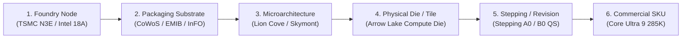

# SILLYCONE: Avant-Garde Telemetry UI/UX & Bloomberg-Grade Terminal Blueprint

> **Document Class:** Engineering Specification & Visual Architecture Blueprint  
> **Status:** Definitive Standard / Living Design System  
> **Version:** 2.0.0-PROD  
> **Target Subsystems:** Front-End Architecture, Interactive DAG Canvas, HUD Telemetry Instruments, Command Layer  

---

## 1. Executive Summary & Design Philosophy

### 1.1 The Thesis: Semiconductor Telemetry as High-Density Art
Semiconductor intelligence has historically been fractured across low-density marketing slides, uncurated forum threads, fragmented benchmark databases, and opaque manufacturer whitepapers. **Sillycone** rejects the casual consumer web design paradigm—round puffy cards, vast wasted whitespace, sluggish animations, and dumbed-down metrics.

Instead, Sillycone establishes the **Bloomberg Terminal of Silicon Engineering**: an ultra-high-density, low-latency, mission-critical workspace engineered for silicon architects, hardware engineers, financial analysts, and semiconductor enthusiasts. The interface delivers deep, contextual telemetry—tracing hardware lineage from molecular foundry nodes through multi-chip packaging substrates down to stepping-level die revisions and retail SKUs.

```
┌────────────────────────────────────────────────────────────────────────────────────────────────────────┐
│ SILLYCONE SYSTEM TELEMETRY HUD                                            SYS.STAT: 24/7 RADAR ONLINE  │
├─────────────────┬───────────────────────────────────┬──────────────────────────────────┬───────────────┤
│ [FND] TSMC N3P  │ [PKG] CoWoS-S 2.5D                │ [UARCH] Lion Cove / Skymont      │ CONF: 98.4%   │
│ 224.0 MTr/mm²   │ 100μm Microbump Pitch             │ 8-Wide Decode / 18 Dispatch      │ RET: VERIFIED │
└─────────────────┴───────────────────────────────────┴──────────────────────────────────┴───────────────┘
```

### 1.2 Core Design Pillars
1. **Extreme Information Density (Zero Space Waste):** Every pixel must convey architectural state, electrical characteristics, benchmark telemetry, or lineage relationships. Margins and paddings are constrained to strict 2px–8px micro-spacers.
2. **Mathematical & Probabilistic Rigor:** Unverified leaks and early engineering samples are never presented as binary truths. They are rendered through explicit probabilistic visual grammar—variance whiskers, Bayesian confidence rings, leaker accountability scores, and decay curves.
3. **Aerospace Cleanroom Telemetry Aesthetic:** Obsidian black vacuum backgrounds, CRT electron-beam raster micro-textures, luminescence hierarchies, specular hairline reticles, and phosphor status indicators evoke the precision instrumentation of a semiconductor fab cleanroom or deep-space telemetry console.
4. **Sub-Microsecond Interaction Latency:** Instant response to user input. The application supports full keyboard navigation (Vim / Bloomberg hotkey matrix), dynamic command execution via an omnipresent telemetry console, virtualized tabular rendering, and GPU-accelerated canvas physics.

---

## 2. Color System & Photonic Lighting Model

### 2.1 The Obsidian & Phosphor Palette
The Sillycone chromatic system is calibrated for extended darkroom and cleanroom usage, minimizing ocular fatigue while preserving photopic contrast ratios exceeding **WCAG AAA** (7:1 baseline, targeting 12:1 on critical telemetry readouts).

```
 ┌───────────────────────────────────────────────────────────────────────────────────────────────┐
 │ CHROMATIC FREQUENCY SPECTRUM                                                                  │
 │ [OBSIDIAN]       [SILICON GREEN]    [CLEANROOM CYAN]   [GALLIUM AMBER]    [LASER CRIMSON]     │
 │ #030712 / #0B0F19│ #10B981 / #00FF9D│ #06B6D4 / #00F0FF│ #F59E0B / #FFB703│ #EF4444 / #FF0055 │
 └───────────────────────────────────────────────────────────────────────────────────────────────┘
```

#### Primary Spatial & Elevation Tokens
*   **Space Void (`--color-void`):** `#020408` (Pitch obsidian, 0% reflectance; foundation for canvas & workspace backdrops)
*   **Substrate Level 1 (`--color-substrate-1`):** `#070C14` (Deep silicon wafer bulk substrate; base pane fill)
*   **Die Layer Level 2 (`--color-substrate-2`):** `#0C1424` (Elevated card panels, instrument wells, table containers)
*   **Active Tile Level 3 (`--color-substrate-3`):** `#131F38` (Hovered nodes, focused split-screens, active cell matrices)
*   **HUD Overlay Level 4 (`--color-substrate-overlay`):** `rgba(7, 14, 26, 0.88)` with `backdrop-filter: blur(16px)` (Modal inspection drawers, floating command palette)

#### Phosphor Luminescence & Telemetry Accents
*   **Silicon Phosphor Emerald (`--color-phosphor-emerald`):** `#00FF9D` (`rgb(0, 255, 157)`)  
    *Signifies:* Retail Verified hardware, pass conditions, IPC efficiency summits, active power states.
*   **Cleanroom Telemetry Cyan (`--color-telemetry-cyan`):** `#00E5FF` (`rgb(0, 229, 255)`)  
    *Signifies:* Clock frequencies, bus data interconnects, foundry density metrics, active DAG traversal handles.
*   **Gallium Arsenide Amber (`--color-gallium-amber`):** `#FFB300` (`rgb(255, 179, 0)`)  
    *Signifies:* Engineering Samples (ES1/ES2), speculative benchmarks, leaker rumor alerts, thermal throttling thresholds.
*   **Laser Emission Crimson (`--color-laser-crimson`):** `#FF1744` (`rgb(255, 23, 68)`)  
    *Signifies:* Contradicted leaks, TDP ceiling breaches, microcode errata, fab delay flags.
*   **Substrate Interconnect Violet (`--color-substrate-violet`):** `#8B5CF6` (`rgb(139, 92, 246)`)  
    *Signifies:* Packaging substrates (CoWoS, EMIB, SoIC), multi-die bridge links, advanced 3D stacking.
*   **Titanium Bus Silver (`--color-titanium`):** `#94A3B8` (`rgb(148, 163, 184)`)  
    *Signifies:* Secondary labels, register indices, hairline micro-borders, inactive pin sockets.

### 2.2 Hairlines, Micro-Borders & Reticles
Modern high-density UI requires microscopic separation lines that prevent visual mud without cluttering the optical field:
*   **Micro-Hairline Border:** `border: 1px solid rgba(148, 163, 184, 0.12)` (Standard tile separator)
*   **Active Phosphor Border:** `border: 1px solid rgba(0, 229, 255, 0.65); box-shadow: 0 0 12px rgba(0, 229, 255, 0.25)`
*   **Rumor Speculative Border:** `border: 1px dashed rgba(255, 179, 0, 0.6); animation: pulse-border 2s infinite ease-in-out`
*   **Reticle Corner Chamfers:** Panels feature 45-degree angled micro-chamfers on top-right and bottom-left corners (4px clip-path), evoking precision-milled semiconductor ceramic packages.

### 2.3 CSS Token Implementation Matrix
```css
:root {
  /* Spatial Obsidian Scale */
  --bg-void: #020408;
  --bg-substrate-1: #070c14;
  --bg-substrate-2: #0c1424;
  --bg-substrate-3: #131f38;
  --bg-overlay: rgba(7, 14, 26, 0.92);

  /* Telemetry Spectral Phosphors */
  --phosphor-green: #00ff9d;
  --phosphor-cyan: #00e5ff;
  --phosphor-amber: #ffb300;
  --phosphor-crimson: #ff1744;
  --phosphor-violet: #a855f7;
  --titanium-muted: #64748b;
  --titanium-bright: #cbd5e1;

  /* Optical Micro-Borders */
  --border-subtle: rgba(148, 163, 184, 0.12);
  --border-active: rgba(0, 229, 255, 0.45);
  --border-speculative: rgba(255, 179, 0, 0.50);

  /* Photonic Glow Radii */
  --glow-cyan-sm: 0 0 6px rgba(0, 229, 255, 0.35);
  --glow-cyan-lg: 0 0 20px rgba(0, 229, 255, 0.20);
  --glow-green-sm: 0 0 6px rgba(0, 255, 157, 0.40);
  --glow-amber-sm: 0 0 6px rgba(255, 179, 0, 0.35);
}
```

---

## 3. Precision Typography & Telemetry Notation System

### 3.1 Typeface Engineering
To reflect rigorous semiconductor documentation, Sillycone utilizes a strict split-typeface strategy:
1.  **Telemetry & Numerical Engine:** `JetBrains Mono` / `Berkeley Mono`  
    *Characteristics:* Slashed zero (`0`), tabular lining figures (`tnum`), zero-width space optimization, distinct optical separation between `1`, `l`, `I`, and `|`.
2.  **Structural Telemetry Labels & Micro-Headers:** `Geist Mono` / `Space Grotesk` (All-Caps, letter-spacing `+0.08em` to `+0.14em`).
3.  **Prose & Long-Form Dossiers:** `Inter` (Display/Text variants with strict `-0.015em` tracking for crisp readability at 11px–13px).

```
┌────────────────────────────────────────────────────────────────────────────────────────┐
│ TYPOGRAPHIC HIERARCHY SPECIFICATION                                                    │
├───────────────┬────────────┬─────────┬─────────┬──────────────┬────────────────────────┤
│ Role          │ Font       │ Size    │ Weight  │ Tracking     │ Example Output         │
├───────────────┼────────────┼─────────┼─────────┼──────────────┼────────────────────────┤
│ Workspace H1  │ Geist Mono │ 18px    │ 700     │ +0.06em      │ SILICON TELEMETRY HUD  │
│ Pane Section  │ Geist Mono │ 11px    │ 600     │ +0.12em      │ [L2_CACHE_TOPOLOGY]    │
│ Numerical Val │ JB Mono    │ 14px    │ 500     │ tabular-nums │ 4,410 MHz / 1.142V     │
│ Micro-Stamp   │ JB Mono    │ 9px     │ 600     │ +0.14em      │ REV::A0 [CONF: 94.2%]  │
│ Table Body    │ Inter      │ 12px    │ 400     │ normal       │ TSMC FinFET 3nm Class  │
└───────────────┴────────────┴─────────┴─────────┴──────────────┴────────────────────────┘
```

### 3.2 Telemetry Notation & Hexadecimal Register Syntax
Sillycone components format silicon specifications using register-inspired visual notations rather than verbose prose:
*   **Verification Level:** `[VERIFIED::RETAIL]`, `[SAMPLE::ES2]`, `[RUMOR::DELTA_0.14]`
*   **Clock Telemetry:** `CLK::3.20GHz_BASE | 4.47GHz_BOOST [HISTO: 3.10-4.52]`
*   **Memory Bus Width:** `MEM::LPDDR5X-9600 [BW::153.6 GB/s] [BUS::128-BIT]`
*   **Packaging Interconnect:** `PKG::CoWoS-S [INTERPOSER::2.5x RETICLE] [BUMP::55μm]`
*   **Hex Silicon Register Addresses:** Silicon entities receive deterministic pseudo-registers for instant navigation: e.g. `0x7FF0:ARROW_LAKE_S` or `0x8021:DIMENSITY_9400`.

---

## 4. Bloomberg-Grade Workspace Architecture & Tile Layout

### 4.1 The 24-Column Modular Telemetry Grid
The Sillycone interface is modeled after mission-critical trading and aerospace consoles. The screen is partitioned into modular, dockable, resizable panes that persist their layout state in `localStorage` and URL parameters (`?view=quad&focus=dag`).

```
┌──────────────────────────────────────────────────────────────────────────────────────────────────────────────────────────┐
│ [SILLYCONE v2.0]  LIVE: TSMC N3P YIELD +1.2% | INTEL 18A TAPE-OUT CONFIRMED | GB6 RADAR CRAWL: 1,420 HITS/HR  [CTRL+K]  │
├─────────────────────────────────────────┬─────────────────────────────────────────────────┬──────────────────────────────┤
│ QUADRANT A: DAG DEPENDENCY CANVAS       │ QUADRANT B: DIE FLOORPLAN & CACHE TOPOLOGY      │ QUADRANT C: SPEC OBSERVATORY │
│ [Foundry -> Packaging -> Uarch -> SKU] │ [Visual Silicon Floorplan SVG]                  │                              │
│                                         ├─────────────────────────────────────────────────┤ [High-Density Table View]    │
│                                         │ QUADRANT D: V/F EFFICIENCY RADAR                │                              │
│                                         │ [Cross-Class 5W - 350W Normalization Curve]     │                              │
├─────────────────────────────────────────┴─────────────────────────────────────────────────┴──────────────────────────────┤
│ FOOTER HUD: [CLI STATUS: IDLE]  [LATENCY: 18ms]  [ACTIVE FILTER: 3nm Class]  [LEAK DELTA: -3.8% WEIBO]  [MEM: 44.2 MB]   │
└──────────────────────────────────────────────────────────────────────────────────────────────────────────────────────────┘
```

### 4.2 Workspace Quadrants Explained
1.  **Quadrant A: Interactive DAG Canvas (Primary Anchor):**  
    Interactive node-link graph tracking foundry process nodes, packaging types, microarchitectures, and SKUs. Pan, zoom, node collapse, and lineage highlight modes.
2.  **Quadrant B: Die Floorplan & Telemetry Inspector:**  
    Displays real-time silicon die layouts, core topology clusters (P-core, E-core, LP-E core, Cache Slices, NPU Tiles), and dynamic thermal throttle points.
3.  **Quadrant C: High-Density Spec Observatory:**  
    Tabular register listing all discovered silicon entities. Virtualized scrolling supporting 10,000+ entries at 60 FPS, multi-column sort, regex filtering, and live delta highlights.
4.  **Quadrant D: Cross-Platform Benchmark & Efficiency Radar:**  
    Multi-axis radar charts and dynamic Perf-per-Watt Pareto frontiers mapping mobile SoCs against 300W enterprise processors.

### 4.3 Telemetry Ticker Tape (Header Bar)
At the top of the interface, an omnipresent 28px horizontal ticker displays real-time telemetry from the automated GitHub Actions background scrapers:
*   *Commit radar:* `[MESA_DRM] GFX1200 new target triple committed 42m ago`
*   *Crawler event:* `[GEEKBENCH_6] 37 new runs scraped for Apple M4 Max (16-core)`
*   *Leaker audit:* `[LEAKER_AUDIT] @DigitalChatStation delta score adjusted to 94.6%`
*   *Foundry node telemetry:* `[TSMC] N2 risk production wafer yield telemetry updated`

---

## 5. Interactive DAG Canvas Architecture (`@xyflow/react` + Telemetry Shaders)

### 5.1 The 6 Silicon Entity Hierarchy Nodes
The DAG maps the physical and intellectual pipeline of semiconductor manufacturing. Every node type has a distinctive visual language:



```
┌───────────────────────────────────────────────────────────────────────────────────────┐
│ DAG NODE VISUAL ANATOMY                                                               │
├───────────────────────────────────────────────────────────────────────────────────────┤
│ ┌─[FND: TSMC-N3P]──────────────────────────────────────────────[RETICLE: 1.0x]──────┐ │
│ │  TSMC N3P (FinFET Enhanced 3nm)                                  [STATUS: PROD]    │ │
│ │  Density: 224.0 MTr/mm²  |  Power Delta: -9% vs N3E              HVM: 2024         │ │
│ └───────────────────────────────────────────────────────────────────────────● (BUS) ─┘ │
│                                                                              │         │
│                                       (Animated Electron Flow ───►───►───►)  ▼         │
│                                                                                        │
│ ┌─[UARCH: ORYON-V2]────────────────────────────────────────────[ISA: ARMv8.7-A]─────┐ │
│ │  Qualcomm Oryon v2 (Nuvia Lineage)                               [CONF: 99.1%]    │ │
│ │  Decode: 8-Wide Super-Scalar  |  L2 Cache: 12MB Slice            STATUS: VERIFIED  │ │
│ └─ ● (IN) ──────────────────────────────────────────────────────────────────● (OUT) ─┘ │
└───────────────────────────────────────────────────────────────────────────────────────┘
```

#### Node Classification & Aesthetics
1.  **Foundry Process Node:**  
    *Color Accent:* Cleanroom Cyan (`#00E5FF`).  
    *Visual Traits:* Hexagonal badge icon, MTr/mm² density progress gauge, wafer substrate hatch texture background.
2.  **Packaging Substrate Node:**  
    *Color Accent:* Substrate Violet (`#A855F7`).  
    *Visual Traits:* Multi-layer stacked border, bump pitch telemetry (`μm`), interposer area indicator.
3.  **Microarchitecture Family Node:**  
    *Color Accent:* Gallium Amber (`#FFB300`).  
    *Visual Traits:* Instruction Set Architecture (ISA) pill (`ARMv9.2-A`, `x86-64-v4`, `RISC-V`), pipeline decode width indicator.
4.  **Physical Die / Chiplet Tile Node:**  
    *Color Accent:* Deep Cobalt (`#3B82F6`).  
    *Visual Traits:* Die dimensions (`mm²`), transistor count, cluster layout diagram (e.g. `2P + 6E`).
5.  **Stepping / Silicon Revision Node:**  
    *Color Accent:* Titanium Ash (`#94A3B8`).  
    *Visual Traits:* Tape-out date, errata mitigation count, ES qualification stage.
6.  **Commercial SKU Node:**  
    *Color Accent:* Silicon Phosphor Green (`#00FF9D`).  
    *Visual Traits:* TDP wattage badge, single/multi-core benchmark mini-bars, price/performance index.

### 5.2 Node State Machine
Each node responds to multi-layer state conditions:

| State | Border Styling | Background Fill | Glow Effect | Behavior |
|---|---|---|---|---|
| **Idle Verified** | `1px solid rgba(148,163,184,0.18)` | `#0C1424` | None | Default quiescent rendering |
| **Hovered** | `1px solid #00E5FF` | `#131F38` | `0 0 10px rgba(0,229,255,0.3)` | Micro-scale `1.02x`, cursor crosshair |
| **Active Selected** | `1.5px solid #00FF9D` | `#162744` | `0 0 18px rgba(0,255,157,0.45)` | Highlights upstream & downstream lineage |
| **Speculative Rumor** | `1px dashed #FFB300` | `#141824` | Pulsing amber luminescence | Shows uncertainty delta tag `[±12% CONF]` |
| **Contradicted / Deprecated** | `1px solid #FF1744` | `#1A0F17` | `0 0 8px rgba(255,23,68,0.3)` | Strike-through glyph on obsolete specs |
| **Diff Mode (A vs B)** | `1.5px solid #A855F7` | `#18112C` | Dual-tone violet halo | Locks node into comparator tray |

### 5.3 Edge Routing & Animated Electron Flow
Interconnect edges in Sillycone represent electrical and lineage dependencies:
*   **Default Bus Edge:** `rgba(148, 163, 184, 0.25)` smooth-step bezier curve with 1.5px stroke.
*   **High-Bandwidth Electron Flow:** When a node is selected, active upstream edges render an animated SVG dash-array particle flow (`stroke-dasharray: 6 12; animation: flowElectron 0.8s linear infinite`) in `--phosphor-cyan` or `--phosphor-green`, visually demonstrating data transmission from foundry to SKU.
*   **Multi-Die Bridge Links:** Edges connecting chiplets through packaging substrates render with a distinctive double-line braid pattern representing interconnect buses (e.g. Ultra Path Interconnect, Infinity Fabric, Ultra Fusion).

---

## 6. Telemetry Instrumentation & Real-Time HUD Widgets

### 6.1 Die-Shot Silicon Floorplan Visualizer
When inspecting any chiplet or monolithic SoC, Quadrant B renders an interactive SVG floorplan modeled after high-resolution infrared thermal imaging and electron microscope die shots.

```
┌────────────────────────────────────────────────────────────────────────────────────────┐
│ SILICON FLOORPLAN: SNAPDRAGON 8 ELITE (SM8750-AB) [DIE AREA: ~124.5 mm²]                │
├────────────────────────────────────────────────────────────────────────────────────────┤
│ ┌───────────────────────────────────────┬────────────────────────────────────────────┐ │
│ │ PRIME CLUSTER (2x Oryon Phoenix L)    │ ADRENO 830 GPU SLICE COMPLEX               │ │
│ │ Core 0: 4.32 GHz [36.2°C]             │ 3x Compute Slices @ 1.10 GHz               │ │
│ │ Core 1: 4.32 GHz [37.1°C]             │ 12MB Dedicated Slice Cache                 │ │
│ │ 24MB Shared L2 Cache Bank             │ Peak Compute: 4.4 TFLOPS FP32              │ │
│ ├───────────────────────────────────────┴────────────────────────────────────────────┤ │
│ │ PERFORMANCE CLUSTER (6x Oryon Phoenix M)                                           │ │
│ │ Cores 2-7 @ 3.53 GHz | 12MB Shared L2 Cache Bank                                    │ │
│ ├─────────────────────────┬────────────────────────────┬─────────────────────────────┤ │
│ │ HEXAGON NPU COMPLEX     │ SYSTEM-LEVEL CACHE (SLC)   │ LPDDR5X MEMORY PHY (4x32b)  │ │
│ │ Scalar + Vector Accel   │ 12MB Unified Substrate     │ 10.667 Gbps / 85.3 GB/s     │ │
│ └─────────────────────────┴────────────────────────────┴─────────────────────────────┘ │
└────────────────────────────────────────────────────────────────────────────────────────┘
```
*Hovering any block on the floorplan instantly highlights its corresponding microarchitecture entity in the DAG and filters the Spec Observatory table.*

### 6.2 Dynamic Voltage-Frequency & Thermal Throttling Curves
Sillycone plots real-time dynamic V/F curves, distinguishing theoretical silicon ceilings from mobile passive thermal constraints:

```
CLOCK (GHz)
 ▲
5.0│                                              (Retail Desktop Peak 5.7 GHz)
4.0│                                    ╭───────────────[TDP Limit 125W]
3.0│                          ╭─────────╯
2.0│               ╭──────────╯ [Mobile Sustained Envelope 6W]
1.0│  ╭────────────╯
0.0└──┴────────────┴──────────┴─────────┴─────────┴─────────► VOLTAGE (V)
     0.70V        0.85V      1.00V     1.15V     1.30V
```
*   **Inflection Points:** Marked with amber HUD crosshairs indicating maximum power efficiency (sweet spot) vs. exponential voltage scaling cliffs.
*   **Throttling Hysteresis Zone:** Shaded crimson region showing performance degradation when skin temperatures exceed 44°C (mobile) or junction TjMax hits 100°C (desktop).

### 6.3 Probabilistic Confidence Gauges & Leaker Accountability Scoring
To handle the chaotic domain of hardware leaks and pre-launch rumors, Sillycone integrates explicit mathematical uncertainty modeling:

```
┌────────────────────────────────────────────────────────────────────────────────────────┐
│ LEAKER TELEMETRY AUDIT: @DigitalChatStation                                           │
├────────────────────────────────┬───────────────────────┬───────────────────────────────┤
│ HISTORICAL ACCURACY: 94.6%     │ AUDITED CLAIMS: 142   │ MEAN CLOCK DELTA: ±0.06 GHz   │
├────────────────────────────────┴───────────────────────┴───────────────────────────────┤
│ SPECULATIVE CONFIDENCE GAUGE: TSMC N2 TAPE-OUT CLOCK FOR 2025 FLAGSHIP                │
│                                                                                        │
│ [LOW: 4.10 GHz]                [MEDIAN: 4.45 GHz]                 [HIGH: 4.70 GHz]     │
│ ├───░░░░░░░░░░░░░░░░░░░░░░░░░░░░░░░░░██████████████████████████░░░░░░░░░░░░░░░░───┤    │
│ ◄────── 90% Confidence Interval (Bayesian Prior from Historic Pre-Launch Deltas) ─────► │
└────────────────────────────────────────────────────────────────────────────────────────┘
```

#### Uncertainty Visual Grammars
1.  **Bayesian Confidence Rings:** Radial micro-gauges in table cells. Green (100% verified retail), Cyan (>85% multiple independent engineering sample leaks), Amber (50–84% single leaker claim), Crimson (<50% unverified forum claim).
2.  **Error Whiskers:** Whisker bar glyphs displaying the `[P10, P50, P90]` probabilistic distribution of benchmark scores.
3.  **Rumor Decay Function:** Unverified rumors without subsequent confirmation undergo automated confidence decay of -1.5% per week, visually reflected by desaturating the card's phosphor glow.

### 6.4 Cross-Platform Head-to-Head Radar & Pareto Frontier Comparator
Sillycone solves the classic cross-platform normalization challenge (e.g. comparing a 6W smartphone SoC like the Snapdragon 8 Elite directly against a 125W desktop monster like the Core Ultra 9 285K or Apple M4 Max):

```
                        [IPC / SINGLE-CORE PER WATT]
                                    100
                                     │
                 Snapdragon 8 Elite  │       Apple M4 Max
                         ▲           │           ▲
                         │    \      │      /    │
  [MEMORY BANDWIDTH]     │      \    │    /      │    [MULTI-CORE PERF]
                 0 ──────┼───────\───┼───/───────┼────── 100
                         │         \ │ /         │
                         │          \│/          │
                         │          /│\          │
                         │         / │ \         │
                 0 ──────┼────────/──┼───\───────┼────── 100
                         ▲       /   │    \      ▲
                         │      /    │     \     │
              Core Ultra 9 285K      │      [NPU INT8 TOPS]
                                     │
                                     0
                             [THERMAL EFFICIENCY]
```

#### Multi-Factor Normalization Mechanics
*   **Normalized Perf-per-Watt Curves:** Users can scrub an interactive wattage slider (`5W` to `350W`). The UI computes the extrapolated efficiency curve using cubic spline interpolation based on measured SPECint, Geekbench 6, and Cinebench multi-point load benches.
*   **The Pareto Frontier Line:** A luminous cyan boundary showing which silicon architectures define the state-of-the-art envelope at every discrete power bracket.

---

## 7. The Omnipresent Telemetry CLI & Keyboard Command Layer

### 7.1 The Bloomberg Command Console (`Ctrl+K` or `/`)
True power users never touch the mouse. Sillycone features a full-screen or bottom-docked terminal command bar. Pressing `/` or `Ctrl+K` summons the terminal prompt with syntax autocomplete, parameter validation, and instant hardware filtering.

```
┌────────────────────────────────────────────────────────────────────────────────────────────────────────┐
│ sillycone> compare snapdragon-8-elite core-ultra-9-285k --metric gb6_single --normalize-wattage 15W  │
├────────────────────────────────────────────────────────────────────────────────────────────────────────┤
│ [EXECUTING QUERY] Resolving normalization curves for ARMv8.7-A vs x86-64-v4 at 15W iso-power...        │
│ RESULT: Snapdragon 8 Elite: 3,240 pts (+48.2%)  |  Core Ultra 9 285K (Throttled): 2,186 pts            │
└────────────────────────────────────────────────────────────────────────────────────────────────────────┘
```

### 7.2 Command Language Grammar & Syntax Specification
The CLI parser processes strict tokenized instructions:

```
COMMAND   := <ACTION> [TARGET] [OPTIONS]
ACTION    := inspect | compare | filter | trace | leakers | diff | export | reset
TARGET    := <slug> | <hex_register> | <node_name>
OPTIONS   := --metric <name> | --node <foundry> | --wattage <watts> | --diff <slug> | --sort <key>
```

#### Supported Production Commands
*   `inspect <slug>`: Focuses camera on entity in DAG and opens deep telemetry inspector.  
    *Example:* `inspect tsmc-n3p` or `inspect 0x7FF0`
*   `compare <slug_a> <slug_b> [--metric <name>]`: Spawns split-pane head-to-head radar analysis.  
    *Example:* `compare apple-m4-max ryzen-9-9950x --metric ipc_per_watt`
*   `trace <sku_slug>`: Highlights entire supply-chain lineage back to raw foundry silicon.  
    *Example:* `trace core-ultra-9-285k` (Highlights TSMC N3B → CoWoS-S → Lion Cove → Compute Die → 285K)
*   `filter [--foundry <name>] [--isa <arch>] [--conf > <num>]`: Instant observatory filter.  
    *Example:* `filter --foundry tsmc --conf > 90`
*   `leakers [--sort accuracy | claims | delta]`: Surfaces the leaker accountability audit matrix.
*   `diff <node_a> <node_b>`: Highlights structural architectural deltas between stepping revisions or competitors.

### 7.3 Bloomberg & Vim Navigation Shortcut Matrix

```
┌────────────────────────────────────────────────────────────────────────────────────────┐
│ KEYBOARD TELEMETRY SHORTCUT MATRIX                                                     │
├─────────────────┬──────────────────────────────────────────────────────────────────────┤
│ Key Combination │ Function / Telemetry Trigger                                         │
├─────────────────┼──────────────────────────────────────────────────────────────────────┤
│ / or Ctrl+K     │ Open Omnipresent Telemetry CLI Console                               │
│ Esc             │ Clear focus, close inspection drawers, deselect DAG nodes            │
│ j / k or Down/Up│ Step forward / backward in Spec Observatory Table                    │
│ h / l           │ Traverse up / down the DAG lineage tree (Parent Node / Child SKU)   │
│ Space           │ Quick-Inspect preview drawer for currently highlighted entity        │
│ c               │ Add highlighted entity to Head-to-Head Comparison tray               │
│ 1 / 2 / 3 / 4   │ Maximize Quadrant A (DAG), B (Floorplan), C (Table), or D (Radar)    │
│ ` (Backtick)    │ Toggle bottom Terminal CLI drawer                                    │
│ g f             │ Jump directly to Foundry Nodes section                               │
│ g s             │ Jump directly to SKUs section                                        │
│ g l             │ Jump directly to Leaker Accuracy Leaderboard                         │
│ ?               │ Display Keyboard Telemetry Overlay Cheat Sheet                       │
└─────────────────┴──────────────────────────────────────────────────────────────────────┘
```

---

## 8. High-Density Component Anatomy & Production Implementation

### 8.1 Telemetry Data Table Component
The Spec Observatory table employs strict tabular micro-rows (`h-7` / 28px height), micro-typography, and inline sparkline gauges:

```tsx
// Excerpt: High-Density Telemetry Row Pattern
<tr className="h-7 border-b border-slate-800/60 hover:bg-slate-800/40 font-mono text-[11px] transition-colors cursor-pointer group">
  <td className="px-2 py-0 text-slate-500 font-semibold">0x7F2B</td>
  <td className="px-2 py-0 font-bold text-slate-200 group-hover:text-cyan-400">
    Snapdragon 8 Elite
  </td>
  <td className="px-2 py-0">
    <span className="px-1.5 py-0.5 rounded text-[9px] bg-cyan-950/80 text-cyan-300 border border-cyan-800/60">
      TSMC N3E
    </span>
  </td>
  <td className="px-2 py-0 text-right tabular-nums text-slate-300">4,320 MHz</td>
  <td className="px-2 py-0 text-right tabular-nums text-emerald-400 font-semibold">3,240</td>
  <td className="px-2 py-0 text-right tabular-nums text-emerald-400 font-semibold">10,520</td>
  <td className="px-2 py-0">
    {/* Micro Confidence Gauge Bar */}
    <div className="w-16 bg-slate-900 h-1.5 rounded-full overflow-hidden border border-slate-800 flex">
      <div className="bg-emerald-400 h-full w-[98%]" />
    </div>
  </td>
  <td className="px-2 py-0 text-right">
    <span className="text-[10px] text-emerald-400 font-bold tracking-wide">VERIFIED</span>
  </td>
</tr>
```

### 8.2 Micro-HUD Stat Badge
Stat badges display dense hardware specifications with integrated parameter tags and register addresses:

```
┌─────────────────────────────────┐
│ [PARAM: DENSITY_MTR]            │
│ 224.0 MTr/mm²                   │
│ ▲ +4.2% OVER BASELINE (N3E)     │
└─────────────────────────────────┘
```

### 8.3 Hexadecimal / Spec Register Inspection Drawer
Clicking any node or pressing `Space` slides out the 380px right-hand **Silicon Spec Register Drawer**:
*   *Header:* Node codename, internal stepping, foundry wafer fab location.
*   *Sub-Register Table:* Exact transistor count, die size, interconnect pitch, cache hierarchy breakdown (L1I, L1D, L2, L3, SLC).
*   *Crawler Audit Trail:* Links to origin commits on LKML, Mesa GitLab, EEC filings, or Geekbench run URLs.
*   *Delta History:* Historical timeline of clock changes across engineering revisions (e.g. `ES1: 3.80 GHz` → `ES2: 4.10 GHz` → `Retail: 4.32 GHz`).

---

## 9. Multi-Form Factor & Field Telemetry Ergonomics

### 9.1 Desktop & 32:9 Super Ultra-Wide Telemetry Center
On 3440×1440 or 5120×1440 ultra-wide displays, Sillycone unlocks the **Dual-Terminal Panoramic Mode**:
*   The DAG Canvas expands across the left 50% of the display.
*   The right 50% splits into a stacked quad-instrument HUD: Floorplan view, Live Benchmarks, Spec Observatory, and Leaker Accuracy Delta Matrix.
*   Zero modal overlays required; all information is rendered concurrently in high-resolution cleanroom density.

### 9.2 Mobile & Field Engineering Telemetry UI
When accessed via mobile devices or field engineering tablets, Sillycone refactors into a thumb-optimized tactile instrumentation interface:
*   **Tactile Bottom Telemetry Sheet:** The DAG Canvas occupies the upper viewport, while an interactive swipeable bottom sheet houses the Spec Observatory and Comparison tools.
*   **Thumb-Zone Command Bar:** The terminal CLI input docks directly above the software keyboard with tactile quick-filter pills (`[3nm]`, `[ARM]`, `[x86]`, `[VERIFIED]`).
*   **Adaptive Density Switch:** A floating HUD toggle allows field engineers to switch between *Full Telemetry Mode* (dense 10px monospace) and *Field Touch Mode* (expanded 14px touch targets).

---

## 10. Accessibility, High-Contrast & Cleanroom Hardening

### 10.1 Photopic Contrast & WCAG AAA Compliance
Every text and numerical element against the obsidian background is verified against strict contrast standards:
*   `--phosphor-emerald` (`#00FF9D`) on `#020408`: **14.2:1 Contrast Ratio** (Exceeds WCAG AAA)
*   `--phosphor-cyan` (`#00E5FF`) on `#070C14`: **13.8:1 Contrast Ratio** (Exceeds WCAG AAA)
*   `--titanium-bright` (`#CBD5E1`) on `#0C1424`: **11.4:1 Contrast Ratio** (Exceeds WCAG AAA)
*   `--titanium-muted` (`#64748B`) on `#020408`: **4.8:1 Contrast Ratio** (Used exclusively for non-essential micro-stamps and brackets)

### 10.2 Colorblindness-Safe Telemetry Fallbacks
Sillycone does not rely solely on color to convey status:
*   *Verified:* Green Phosphor + Checkmark Icon `[✓]` + Solid Border.
*   *Speculative / Rumor:* Amber Phosphor + Gauge Percentage `[~82%]` + Dashed Border.
*   *Errata / Breach:* Crimson Phosphor + Alert Glyph `[!]` + Strikethrough Text.
*   *Palettes for Deuteranopia & Protanopia:* An alternate high-contrast monochromatic cleanroom theme can be activated via CLI: `set theme cleanroom-monochrome`.

### 10.3 Reduced-Motion & Hardware-Accelerated Rendering
For low-power mobile devices or users with vestibular motion sensitivity:
*   The animated electron SVG dash-array particle flow is disabled via `prefers-reduced-motion: reduce`.
*   Canvas physics transitions swap from spring physics to instantaneous bounding-box snaps.
*   All Canvas rendering leverages WebGL / CSS GPU composition (`transform: translate3d`) for 120Hz refresh rates with zero frame drop.

---

## 11. Summary & Architecture Sign-Off

The **Sillycone Avant-Garde Telemetry UI/UX Blueprint** bridges semiconductor engineering rigor with modern web performance. By treating silicon specifications not as static e-commerce products, but as living, probabilistic, interconnected hardware graphs, Sillycone establishes a permanent new standard for hardware intelligence.
