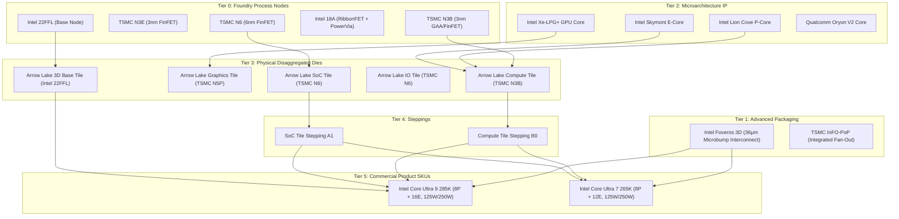
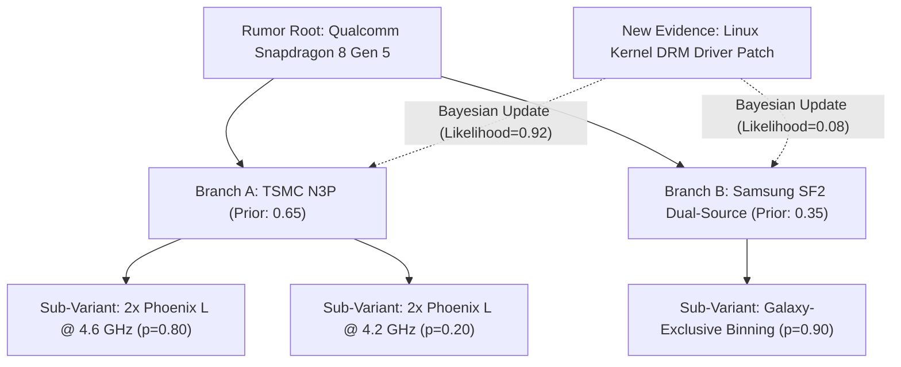

# SILLYCONE: Definitive Taxonomy DAG, Probabilistic Spec Model, and Cross-Platform Benchmark Normalization Engine

> **Document Identifier:** `SIL-ARCH-003`  
> **Status:** Standard Reference Specification  
> **Target Revision:** v2.0  
> **Scope:** Full-Spectrum Semiconductor Knowledge Graph, Multi-Tier Hardware Hierarchy, Uncertainty Quantification, Leaker Scoring, and Unified Perf-per-Watt Normalization.

---

## 1. Executive Summary & Architectural Mission

Modern semiconductor analysis is severely broken by fragmented, siloed, and marketing-distorted metrics. Smartphone system-on-chips (SoCs) operating within strict 4–7 W fanless envelopes are routinely compared against 125–253 W unlocked desktop flagships or 450 W discrete GPUs using conflicting run-times, uncalibrated power metrics, and transient boost states. Concurrently, unreleased silicon specs leak months in advance across fragmented channels (Weibo, Chiphell, Linux kernel mailing lists, X/Twitter, customs manifests), yielding contradictory rumors without mathematical provenance or accountability.

**Sillycone** solves this via two foundational engineering engines:

1. **The 6-Tier Directed Acyclic Graph (DAG) Hardware Hierarchy**:  
   Abandoning simplistic flat "chip" tables, Sillycone treats silicon as a deterministic DAG tracking dependencies from atomic lithographic nodes and physical packaging substrates down to microarchitecture families, discrete physical dies/chiplets, silicon steppings, and commercially binned product SKUs.
2. **The Probabilistic Spec & Unified Benchmark Normalization Engine**:  
   Treating unreleased hardware as probabilistic distributions rather than static scalar fields, computing dynamic confidence intervals, Bayesian rumor branching, and an empirical Leaker Accountability Score ($LAS$). Standardizing cross-platform compute across Geekbench 6/7, Cinebench, 3DMark, and NPU workloads into calibrated **Performance-per-Watt ($\text{Perf/W}$)** efficiency curves that accurately compare an ultra-low-power mobile SoC with a monolithic workstation behemoth.

```
┌────────────────────────────────────────────────────────────────────────────────────────────────────────┐
│                                       SILLYCONE KNOWLEDGE GRAPH                                        │
└────────────────────────────────────────────────────────────────────────────────────────────────────────┘
                                                    │
                   ┌────────────────────────────────┴────────────────────────────────┐
                   ▼                                                                 ▼
   ┌───────────────────────────────┐                                 ┌───────────────────────────────┐
   │     6-TIER HARDWARE DAG       │                                 │   PROBABILISTIC SPEC ENGINE   │
   │                               │                                 │                               │
   │ [L0] Foundry Process Node     │                                 │ • Bayesian Rumor Trees        │
   │   │                           │                                 │ • Confidence Interval [θ±δ]   │
   │ [L1] Packaging & Interconnect │                                 │ • Multi-Stage Life Cycle      │
   │   │                           │                                 │ • Leaker Brier & WMAPE Scoring│
   │ [L2] Microarchitecture Family │                                 └───────────────┬───────────────┘
   │   │                           │                                                 │
   │ [L3] Physical Dies / Tiles    │                                                 │
   │   │                           │                                                 │
   │ [L4] Steppings & Silicon Rev  │                                                 │
   │   │                           │                                                 │
   │ [L5] Commercial Product SKU   │                                                 │
   └───────────────┬───────────────┘                                                 │
                   │                                                                 │
                   └────────────────────────────────┬────────────────────────────────┘
                                                    │
                                                    ▼
                   ┌─────────────────────────────────────────────────────────────────┐
                   │            CROSS-PLATFORM BENCHMARK NORMALIZATION               │
                   │                                                                 │
                   │ • Sub-system Package vs. Wall Power Isolation (RAPL / PMIC)     │
                   │ • Dynamic Voltage-Frequency Curve Modeling (P = C·V²·f + Pleak) │
                   │ • Normalized Efficiency Index (NEI) & Iso-Power/Iso-Perf AUC    │
                   │ • Unified Metric Vectors (GB6/7, CB R23/2024, 3DMark, Real TOPS)│
                   └─────────────────────────────────────────────────────────────────┘
```

---

## 2. Complete DAG Entity Hierarchy (The 6-Tier Hardware Ontology)

In legacy databases, a "chip" is stored as a single row containing a process node, clock speed, and core count. This abstraction collapses when handling modern disaggregated multi-chiplet modules (MCMs) such as Intel Core Ultra 200S (*Arrow Lake-S*), AMD Ryzen 9000 (*Granite Ridge*), or Apple M-Series Ultra packages, where a single product contains dies fabricated across three distinct foundries, different lithographic nodes, and bonded via heterogeneous packaging.

Sillycone implements a strict 6-tier Directed Acyclic Graph (DAG):

```
Foundry Node (L0) ───────┐
                         ▼
Packaging Substrate (L1) ───► Physical Dies/Tiles (L3) ──► Steppings (L4) ──► Product SKUs (L5)
                                      ▲
Microarchitecture Family (L2) ────────┘
```

---

### 2.1 Tier 0: Foundry Process Nodes (`foundry_nodes`)

The lithographic foundation. Characterizes the physical transistor fabrication process, standard cell library scaling, metal stack geometry, and electrostatic limits.

* **Primary Key:** `node_id` (UUID) / `node_slug` (e.g., `tsmc-n3p`, `intel-18a`, `samsung-sf2`).
* **Critical Physical Attributes:**
  * **Transistor Architecture:** `FinFET`, `GAAFET / Nanosheet` (e.g., Samsung MBCFET, Intel RibbonFET, TSMC Nanosheet), `Complementary FET (CFET)`.
  * **Contacted Poly Pitch (CPP / Gate Pitch):** Measured in nanometers ($nm$). Defines the minimum distance between adjacent transistor gates.
  * **Minimum Metal Pitch (M1P / MxP):** Measured in nanometers ($nm$). Interconnect routing density.
  * **Transistor Density Metric:** Expressed in $\text{MTr/mm}^2$ (Million Transistors per square millimeter) calculated via the standard IEDM formula:
    $$D = 0.67 \times \left(\frac{C_H}{\text{CPP} \times \text{M1P}}\right)_{\text{2-input NAND}} + 0.33 \times \left(\frac{C_H}{\text{CPP} \times \text{M1P}}\right)_{\text{Scan Flip-Flop}}$$
  * **SRAM Bitcell Size:** High-Density (HD) and High-Performance (HP) SRAM cell areas in $\mu\text{m}^2$ (e.g., TSMC N3E HD SRAM $= 0.021\,\mu\text{m}^2$).
  * **Power Delivery Network (PDN):** Traditional Front-Side Power Delivery Network (FSPDN) vs. Backside Power Delivery Network (BSPDN) (e.g., Intel PowerVia, TSMC A16 Super Power Rail).
  * **Nominal $V_{dd}$ & $V_{min}$ Operating Window:** Minimum stable voltage threshold and maximum breakdown voltage.
  * **Baseline Iso-Power/Iso-Performance Deltas:** Relative performance gain ($\%$) at fixed power, and power reduction ($\%$) at fixed frequency compared to predecessor.

---

### 2.2 Tier 1: Packaging Substrates & Advanced Interconnects (`packaging_substrates`)

Modern high-performance silicon relies on advanced 2.5D and 3D heterogeneous integration to overcome the reticle limit ($\approx 858\,\text{mm}^2$).

* **Primary Key:** `packaging_id` (UUID) / `packaging_slug` (e.g., `tsmc-cowos-l`, `intel-foveros-direct-3d`, `apple-ultrafusion`).
* **Critical Physical Attributes:**
  * **Topology Class:**
    * `Monolithic`: Standard single-die wirebond / flip-chip BGA.
    * `2D Multi-Chip Module (MCM)`: Organic laminate package substrate.
    * `2.5D Interposer`: Passive or active silicon, silicon bridge, or RDL interposer (e.g., TSMC CoWoS-S/R/L, Intel EMIB).
    * `3D Die Stacking`: Direct vertical wafer-on-wafer or die-on-wafer hybrid bonding (e.g., TSMC SoIC, Intel Foveros 3D, AMD 3D V-Cache).
    * `InFO-PoP`: Integrated Fan-Out Package-on-Package (mobile standard for low z-height and high-bandwidth DRAM stacking).
  * **Bond Pitch / Microbump Pitch:** Measured in micrometers ($\mu\text{m}$). From $55\,\mu\text{m}$ (standard microbumps) down to $<9\,\mu\text{m}$ (direct Cu-Cu hybrid bonding).
  * **Die-to-Die Interconnect Interface:** Standardized protocols (`UCIe 1.0/2.0`, `BoW - Bunch of Wires`, `AIB`) or proprietary interfaces (`Apple UltraFusion`, `AMD IFOP`, `Intel MDFI`).
  * **Interconnect Shoreline Bandwidth Density:** Expressed in $\text{TB/s per mm}$ of die edge.
  * **Area Bandwidth Density:** Expressed in $\text{TB/s per mm}^2$.
  * **Interconnect Energy Efficiency:** Measured in Picojoules per bit ($\text{pJ/bit}$). High-efficiency chiplet interconnects target $<0.5\,\text{pJ/bit}$.
  * **Die-to-Die Latency Penalty:** Roundtrip transit latency (nanoseconds, $\text{ns}$) introduced by crossing the boundary compared to on-die crossbar/mesh traversal.

---

### 2.3 Tier 2: Microarchitecture Families & Core IP (`microarchitectures`)

Logical IP designs that can be instantiated across multiple physical dies and fab nodes.

* **Primary Key:** `microarch_id` (UUID) / `microarch_slug` (e.g., `intel-lion-cove`, `amd-zen5`, `arm-cortex-x925`, `qualcomm-oryon-v2`, `nvidia-blackwell-sm`).
* **Critical Architectural Attributes:**
  * **Instruction Set Architecture (ISA):** e.g., `x86-64-v4`, `ARMv9.2-A`, `ARMv9.4-A`, `RISC-V RVA22`.
  * **Core Category:** `P-Core (Performance)`, `E-Core (Efficiency)`, `LP-E (Low-Power Efficiency)`, `GPU Compute Unit / SM`, `NPU Core / Tensor Engine`, `DSP / ISP`.
  * **Front-End Pipeline Metrics:**
    * Branch Predictor Architecture & Branch Target Buffer (BTB) size.
    * Instruction Fetch Width (bytes/cycle).
    * Instruction Decode Width (e.g., 8-wide Lion Cove, 8-wide Zen 5, 8-wide Apple M4 Firestorm descendant).
    * Micro-op ($\mu\text{op}$) Cache capacity.
  * **Execution Engine Metrics:**
    * Reorder Buffer (ROB) Depth (e.g., Lion Cove 576 entries, Apple M4 >600 entries, Zen 5 448 entries).
    * Integer and Floating Point execution ports and dispatch width.
    * Vector Execution Capabilities: AVX-512 with single/dual 512-bit pipes, ARM SVE2, AMX / SME matrix engines.
  * **Memory Subsystem:**
    * L1 Instruction / Data Cache size and latency (e.g., 48 KB 12-way L1D, 4-cycle load-to-use).
    * Dedicated Private L2 Cache size (e.g., 2.5 MB to 3.0 MB per P-core).
  * **IPC Reference Delta:** Baseline geometric mean IPC delta ($\%$) measured against a canonical predecessor reference across SPEC CPU 2017.

---

### 2.4 Tier 3: Physical Dies, Tiles & Chiplets (`physical_dies`)

The physical slice of processed silicon that exits the wafer before assembly. A modern processor is composed of one or more physical dies.

* **Primary Key:** `die_id` (UUID) / `die_slug` (e.g., `intel-arw-compute-die`, `amd-zen5-ccd-eldora`, `apple-m4-max-die`).
* **Relationships:**
  * `foundry_node_id` $\rightarrow$ Points to Tier 0 (`foundry_nodes`).
* **Physical Attributes:**
  * **Die Dimensions:** Width ($mm$), Height ($mm$), and Total Area ($\text{mm}^2$).
  * **Transistor Count:** Billions of transistors ($B$).
  * **Yield Modeling & Wafer Defect Density ($D_0$):**
    Using the **Murphy-Seeds** or **Negative Binomial (Bose-Einstein)** Yield Equation:
    $$Y = \left( 1 + \frac{D_0 \cdot A}{\alpha} \right)^{-\alpha}$$
    where $A$ is the die area in $\text{cm}^2$, $D_0$ is defect density (typically $0.05 \text{ to } 0.15 \text{ defects/cm}^2$ for mature nodes), and $\alpha$ is the defect cluster parameter ($\approx 2.0$).
  * **Good Dies Per Wafer (DPW):** Computed via wafer diameter ($300\,\text{mm}$ standard):
    $$\text{Gross Dies} = \pi \left( \frac{d}{2} \right)^2 \frac{1}{A} - \frac{\pi d}{\sqrt{2 A}}, \quad \text{Net Good Dies} = \text{Gross Dies} \times Y$$
  * **Integrated IP Core Clusters:** Array of instantiated Tier 2 microarchitectures (e.g., $8\times$ Zen 5 P-cores with 32 MB shared L3 cache).
  * **Integrated On-Die Interconnect:** Mesh, Ring Bus, Crossbar, or Network-on-Chip (NoC) clock frequency and bi-directional bisection bandwidth ($\text{GB/s}$).

---

### 2.5 Tier 4: Silicon Steppings & Revisions (`silicon_steppings`)

Silicon spins, metal fixes, and tapeout revisions that directly modify electrical properties, power curves, and fix critical hardware errata.

* **Primary Key:** `stepping_id` (UUID) / `stepping_code` (e.g., `A0`, `A1`, `B0`, `B1`, `C0`).
* **Relationships:**
  * `die_id` $\rightarrow$ Points to Tier 3 (`physical_dies`).
* **Critical Tracking Attributes:**
  * **Tapeout Iteration:**
    * `A0`: Initial full-mask tapeout (Engineering Samples, ES1). High leakage, unoptimized $V/F$ curves, active errata.
    * `A1 / A2`: Metal-layer-only mask fixes. Low cost, fast turnaround ($2\text{--}4$ weeks). Fixes minor logical bugs without altering base diffusion.
    * `B0`: Full-mask respin (ES2 / Qualification Samples, QS). Rerouted interconnects, lithographic optical proximity correction (OPC) tuning, updated standard cell placement. Often delivers $+5\text{--}10\%$ clock speed or $-15\%$ power draw.
    * `C0 / D0`: Production refresh steppings. Mature commercial yield optimization.
  * **CPUID / Silicon ID Register:** Raw bitmask reported by hardware MSR / registers (e.g., CPUID Family, Model, Stepping).
  * **Fixed Hardware Errata:** Formal CVE and silicon errata list resolved by this stepping.
  * **$V/F$ Scaling Shift:** Voltage-Frequency curve adjustments relative to initial A0 silicon.

---

### 2.6 Tier 5: Commercial Product SKUs (`product_skus`)

The consumer- or enterprise-facing product sold in the market. A SKU represents the final commercial binning of assembled, packaged dies.

* **Primary Key:** `sku_id` (UUID) / `sku_slug` (e.g., `qualcomm-snapdragon-8-elite`, `amd-ryzen-9-9950x`, `intel-core-ultra-9-285k`, `apple-m4-pro-14c`).
* **Relationships:**
  * `packaging_id` $\rightarrow$ Points to Tier 1 (`packaging_substrates`).
  * `sku_die_mapping` $\rightarrow$ Junction table joining $1\dots N$ Tier 4 Steppings and physical dies into this product.
* **Commercial & Thermal Specs:**
  * **Marketing Brand & Codename:** e.g., `Intel Core Ultra 9 285K`, Codename `Arrow Lake-S`.
  * **Platform Segment:** `mobile_soc`, `handheld_apu`, `laptop_client`, `desktop_cpu`, `workstation_hedt`, `discrete_gpu`, `datacenter_ai`.
  * **Binning Profile & Core Harvesting:** Fused-off cores/execution units (e.g., 16 CUs active out of 20 physical CUs on die).
  * **Thermal Design Power Envelopes:**
    * $P_{\text{base}}$ / PL1: Sustained Base Power (W).
    * $P_{\text{max}}$ / PL2 / PPT: Peak Short-Term Boost Power (W).
    * Tau ($\tau$): PL2 duration window in seconds.
    * Handheld/Mobile cTDP: Configurable operating bounds (e.g., $15\text{--}30\,\text{W}$).
  * **Memory Subsystem Specifications:** Supported standards (`LPDDR5X-9600`, `DDR5-6400`, `GDDR7`, `HBM3e`), bus width (bits), peak bandwidth ($\text{GB/s}$), and ECC capabilities.

---

### 2.7 Complete Multi-Die Architecture Graph (Case Study: Intel Arrow Lake-S & Apple M4 Max)

The power of this 6-tier DAG is demonstrated by decomposing complex heterogeneous architectures:



---

## 3. Relational & Graph Data Architecture (PostgreSQL / Supabase Schema)

The Sillycone storage layer is implemented in PostgreSQL 15+ hosted on Supabase. It uses strict foreign key relationships, multi-column indexes, JSONB for extensible electrical parameters, and recursive Common Table Expressions (CTEs) for instantaneous DAG traversal.

### 3.1 Extended Production DDL

```sql
-- ====================================================================
-- SILLYCONE 6-TIER HARDWARE DAG & BENCHMARK SCHEMA
-- Target: PostgreSQL 15+ / Supabase
-- ====================================================================

CREATE EXTENSION IF NOT EXISTS "uuid-ossp";

-- --------------------------------------------------------------------
-- ENUMS
-- --------------------------------------------------------------------
CREATE TYPE platform_segment AS ENUM (
    'mobile_soc',
    'handheld_apu',
    'laptop_client',
    'desktop_cpu',
    'workstation_hedt',
    'discrete_gpu',
    'datacenter_ai'
);

CREATE TYPE verification_stage AS ENUM (
    'early_rumor',        -- Leaker whispers, Weibo/X posts (Confidence 10-35%)
    'patent_or_driver',   -- Linux kernel DRM/LLVM commits, EEC regulatory entries (35-65%)
    'es_sample_hit',      -- Geekbench/3DMark browser test submissions (65-85%)
    'announced',          -- Official vendor keynote/whitepaper (85-95%)
    'retail_verified'     -- Tested in-lab on production retail silicon (100% Ground Truth)
);

CREATE TYPE benchmark_suite AS ENUM (
    'geekbench_6_single',
    'geekbench_6_multi',
    'geekbench_7_single',
    'geekbench_7_multi',
    'cinebench_r23_single',
    'cinebench_r23_multi',
    'cinebench_2024_single',
    'cinebench_2024_multi',
    '3dmark_steel_nomad',
    '3dmark_time_spy_graphics',
    '3dmark_wild_life_extreme',
    '3dmark_solar_bay',
    'geekbench_ai_quantized',
    'llm_tokens_sec_llama8b_q4'
);

CREATE TYPE packaging_topology AS ENUM (
    'monolithic',
    'mcm_substrate_2d',
    'interposer_25d',
    'die_stacking_3d',
    'fanout_info_pop'
);

-- --------------------------------------------------------------------
-- TIER 0: FOUNDRY PROCESS NODES
-- --------------------------------------------------------------------
CREATE TABLE foundry_nodes (
    id UUID PRIMARY KEY DEFAULT uuid_generate_v4(),
    slug VARCHAR(64) UNIQUE NOT NULL,
    foundry_name VARCHAR(64) NOT NULL,              -- 'TSMC', 'Intel Foundry', 'Samsung'
    node_name VARCHAR(64) NOT NULL,                 -- 'N3P', '18A', 'SF2'
    transistor_architecture VARCHAR(48) NOT NULL,   -- 'FinFET', 'GAAFET/Nanosheet', 'RibbonFET'
    gate_pitch_cpp_nm NUMERIC(6, 2),                -- Contacted Poly Pitch (nm)
    metal_pitch_m1p_nm NUMERIC(6, 2),               -- Minimum Metal Pitch (nm)
    density_mtr_mm2 NUMERIC(8, 2) NOT NULL,         -- Million Transistors per mm²
    sram_bitcell_hd_um2 NUMERIC(6, 4),              -- High-Density SRAM bitcell area (µm²)
    sram_bitcell_hp_um2 NUMERIC(6, 4),              -- High-Performance SRAM bitcell area (µm²)
    backside_power BOOLEAN DEFAULT FALSE,           -- True for PowerVia / Super Power Rail
    nominal_voltage_v NUMERIC(4, 2) DEFAULT 0.75,   -- Nominal operating Vdd
    status VARCHAR(32) DEFAULT 'production',        -- 'rd', 'risk_production', 'production'
    hvm_year INT,                                   -- High Volume Manufacturing Year
    created_at TIMESTAMPTZ DEFAULT NOW(),
    updated_at TIMESTAMPTZ DEFAULT NOW()
);

-- --------------------------------------------------------------------
-- TIER 1: PACKAGING SUBSTRATES & INTERCONNECTS
-- --------------------------------------------------------------------
CREATE TABLE packaging_substrates (
    id UUID PRIMARY KEY DEFAULT uuid_generate_v4(),
    slug VARCHAR(64) UNIQUE NOT NULL,
    vendor VARCHAR(64) NOT NULL,                    -- 'TSMC', 'Intel', 'ASE', 'Amkor'
    technology_name VARCHAR(96) NOT NULL,           -- 'CoWoS-L', 'Foveros Direct 3D', 'EMIB'
    topology packaging_topology NOT NULL,
    microbump_pitch_um NUMERIC(6, 2),               -- Microbump / Hybrid bond pitch (µm)
    d2d_bandwidth_density_tb_s_mm NUMERIC(6, 2),    -- Shoreline Bandwidth (TB/s per mm)
    energy_per_bit_pj NUMERIC(5, 3),                -- Energy efficiency (pJ/bit)
    interconnect_latency_ns NUMERIC(5, 2),          -- Traversal latency penalty (ns)
    standard_compliance VARCHAR(64),                -- 'UCIe 2.0', 'BoW', 'Proprietary'
    created_at TIMESTAMPTZ DEFAULT NOW()
);

-- --------------------------------------------------------------------
-- TIER 2: MICROARCHITECTURE FAMILIES
-- --------------------------------------------------------------------
CREATE TABLE microarchitectures (
    id UUID PRIMARY KEY DEFAULT uuid_generate_v4(),
    slug VARCHAR(64) UNIQUE NOT NULL,
    name VARCHAR(96) NOT NULL,                      -- 'Lion Cove', 'Zen 5', 'Oryon Gen 2'
    designer VARCHAR(64) NOT NULL,                  -- 'Intel', 'AMD', 'Qualcomm', 'Apple', 'ARM'
    isa VARCHAR(32) NOT NULL,                       -- 'x86-64-v4', 'ARMv9.2-A'
    decode_width INT NOT NULL,                      -- Instructions decoded per cycle
    reorder_buffer_size INT,                        -- ROB entries
    execution_ports INT,
    vector_width_bits INT,                          -- 128, 256, 512 (AVX-512)
    native_matrix_unit BOOLEAN DEFAULT FALSE,       -- AMX, SME
    l1i_cache_kb INT NOT NULL,
    l1d_cache_kb INT NOT NULL,
    spec_ipc_delta_percent NUMERIC(5, 2),           -- Baseline IPC delta vs. prior gen
    created_at TIMESTAMPTZ DEFAULT NOW()
);

-- --------------------------------------------------------------------
-- TIER 3: PHYSICAL DIES / CHIPLETS / TILES
-- --------------------------------------------------------------------
CREATE TABLE physical_dies (
    id UUID PRIMARY KEY DEFAULT uuid_generate_v4(),
    slug VARCHAR(96) UNIQUE NOT NULL,
    codename VARCHAR(96) NOT NULL,                  -- 'Eldora CCD', 'Arrow Lake Compute Tile'
    foundry_node_id UUID NOT NULL REFERENCES foundry_nodes(id) ON DELETE RESTRICT,
    die_area_mm2 NUMERIC(7, 2) NOT NULL,
    transistor_count_billions NUMERIC(7, 2),
    wafer_defect_density_d0 NUMERIC(5, 3) DEFAULT 0.08, -- Defects per cm²
    estimated_yield_percent NUMERIC(5, 2),          -- Derived via Murphy-Seeds formula
    on_die_interconnect_type VARCHAR(64),           -- 'Ring Bus', 'Mesh', 'Crossbar', 'NoC'
    created_at TIMESTAMPTZ DEFAULT NOW()
);

-- Junction: Die contains 1 to N Microarchitecture instances
CREATE TABLE die_ip_clusters (
    id UUID PRIMARY KEY DEFAULT uuid_generate_v4(),
    die_id UUID NOT NULL REFERENCES physical_dies(id) ON DELETE CASCADE,
    microarch_id UUID NOT NULL REFERENCES microarchitectures(id) ON DELETE RESTRICT,
    cluster_label VARCHAR(64) NOT NULL,             -- 'P-Core Cluster', 'E-Core Cluster', 'Compute Unit Array'
    core_count INT NOT NULL,
    l2_cache_per_core_kb INT,
    shared_l3_cache_mb NUMERIC(6, 2)
);

-- --------------------------------------------------------------------
-- TIER 4: SILICON STEPPINGS & REVISIONS
-- --------------------------------------------------------------------
CREATE TABLE silicon_steppings (
    id UUID PRIMARY KEY DEFAULT uuid_generate_v4(),
    die_id UUID NOT NULL REFERENCES physical_dies(id) ON DELETE CASCADE,
    stepping_code VARCHAR(16) NOT NULL,             -- 'A0', 'A1', 'B0', 'C0'
    cpuid_signature VARCHAR(32),                    -- Hardware CPUID bitmask
    is_commercial_production BOOLEAN DEFAULT FALSE,
    vf_curve_shift_mv INT DEFAULT 0,                -- Millivolt offset vs. A0
    resolved_errata TEXT[],
    release_date DATE,
    created_at TIMESTAMPTZ DEFAULT NOW(),
    UNIQUE(die_id, stepping_code)
);

-- --------------------------------------------------------------------
-- TIER 5: PRODUCT SKUS (COMMERCIAL SILICON ENTITIES)
-- --------------------------------------------------------------------
CREATE TABLE product_skus (
    id UUID PRIMARY KEY DEFAULT uuid_generate_v4(),
    slug VARCHAR(128) UNIQUE NOT NULL,
    marketing_name VARCHAR(128) NOT NULL,           -- 'Qualcomm Snapdragon 8 Elite', 'Ryzen 9 9950X'
    commercial_code VARCHAR(64),                    -- 'SM8750-AB', '100-000001277'
    vendor VARCHAR(64) NOT NULL,                    -- 'Qualcomm', 'AMD', 'Apple', 'Intel'
    segment platform_segment NOT NULL,
    packaging_id UUID REFERENCES packaging_substrates(id) ON DELETE SET NULL,
    
    -- Thermal Envelopes
    tdp_base_w NUMERIC(6, 2) NOT NULL,              -- PL1 / Base TDP (W)
    tdp_boost_w NUMERIC(6, 2) NOT NULL,             -- PL2 / PPT / Max TGP (W)
    tau_seconds NUMERIC(5, 1),                      -- Boost duration window
    
    -- Lifecycle & Verification
    stage verification_stage NOT NULL DEFAULT 'early_rumor',
    overall_confidence_score INT DEFAULT 50 CHECK (overall_confidence_score BETWEEN 0 AND 100),
    expected_launch VARCHAR(32),                    -- 'Q4 2025'
    retail_launch_date DATE,
    created_at TIMESTAMPTZ DEFAULT NOW(),
    updated_at TIMESTAMPTZ DEFAULT NOW()
);

-- Junction: A Product SKU is assembled from 1 to N Physical Dies / Steppings
CREATE TABLE sku_die_mapping (
    id UUID PRIMARY KEY DEFAULT uuid_generate_v4(),
    sku_id UUID NOT NULL REFERENCES product_skus(id) ON DELETE CASCADE,
    stepping_id UUID NOT NULL REFERENCES silicon_steppings(id) ON DELETE RESTRICT,
    quantity INT DEFAULT 1,                         -- e.g. 2x CCDs on Ryzen 9 9950X
    active_cores_override INT,                      -- Binning: active cores out of physical cores
    base_clock_mhz INT NOT NULL,
    boost_clock_mhz INT NOT NULL,
    fused_features JSONB DEFAULT '{}'::jsonb        -- Disabled units, cache fused off
);

-- Memory Subsystem for SKU
CREATE TABLE sku_memory_specs (
    id UUID PRIMARY KEY DEFAULT uuid_generate_v4(),
    sku_id UUID UNIQUE NOT NULL REFERENCES product_skus(id) ON DELETE CASCADE,
    memory_type VARCHAR(32) NOT NULL,               -- 'LPDDR5X-9600', 'DDR5-6400', 'GDDR7'
    bus_width_bits INT NOT NULL,                    -- 128, 192, 256, 384
    peak_bandwidth_gb_s NUMERIC(7, 2) NOT NULL,
    max_capacity_gb INT
);

-- --------------------------------------------------------------------
-- PROBABILISTIC SPECIFICATION ENGINE & RUMORS
-- --------------------------------------------------------------------
CREATE TABLE leakers (
    id UUID PRIMARY KEY DEFAULT uuid_generate_v4(),
    handle VARCHAR(96) UNIQUE NOT NULL,             -- 'Digital Chat Station', 'Kopite7kimi'
    primary_channel VARCHAR(64) NOT NULL,           -- 'Weibo', 'X / Twitter', 'Chiphell'
    reliability_tier VARCHAR(16) DEFAULT 'B',       -- 'S', 'A', 'B', 'C', 'D'
    total_predictions INT DEFAULT 0,
    verified_accurate INT DEFAULT 0,
    verified_in_margin INT DEFAULT 0,
    debunked INT DEFAULT 0,
    brier_score NUMERIC(6, 4) DEFAULT 0.2500,       -- Mean Squared Prediction Error
    wmape_score NUMERIC(6, 4),                      -- Weighted Mean Absolute Percentage Error
    created_at TIMESTAMPTZ DEFAULT NOW()
);

CREATE TABLE rumor_spec_branches (
    id UUID PRIMARY KEY DEFAULT uuid_generate_v4(),
    sku_id UUID NOT NULL REFERENCES product_skus(id) ON DELETE CASCADE,
    branch_name VARCHAR(64) NOT NULL,               -- 'Branch A: TSMC N3P + 4.3 GHz', 'Branch B: Samsung 3GAP'
    prior_probability NUMERIC(4, 3) NOT NULL,       -- P(H_i), must sum to 1.0 across active branches
    posterior_probability NUMERIC(4, 3) NOT NULL,   -- Updated dynamically via Bayes Theorem
    is_active BOOLEAN DEFAULT TRUE,
    created_at TIMESTAMPTZ DEFAULT NOW()
);

CREATE TABLE spec_predictions (
    id UUID PRIMARY KEY DEFAULT uuid_generate_v4(),
    sku_id UUID NOT NULL REFERENCES product_skus(id) ON DELETE CASCADE,
    branch_id UUID REFERENCES rumor_spec_branches(id) ON DELETE SET NULL,
    leaker_id UUID NOT NULL REFERENCES leakers(id) ON DELETE CASCADE,
    metric_name VARCHAR(64) NOT NULL,               -- 'boost_clock_mhz', 'gb6_single_score', 'tdp_w'
    predicted_scalar NUMERIC(10, 2),                -- Scalar point prediction if applicable
    predicted_ci_low NUMERIC(10, 2),                -- 95% Confidence Interval Lower Bound
    predicted_ci_high NUMERIC(10, 2),               -- 95% Confidence Interval Upper Bound
    actual_retail_value NUMERIC(10, 2),             -- Ground truth upon retail validation
    error_percentage NUMERIC(6, 2),                 -- Computed delta
    source_url TEXT,
    recorded_date DATE NOT NULL DEFAULT CURRENT_DATE,
    verified_date DATE,
    status VARCHAR(32) DEFAULT 'pending'            -- 'pending', 'confirmed', 'in_margin', 'debunked'
);

-- --------------------------------------------------------------------
-- NORMALIZED BENCHMARKS & EFFICIENCY MATRICES
-- --------------------------------------------------------------------
CREATE TABLE normalized_benchmarks (
    id UUID PRIMARY KEY DEFAULT uuid_generate_v4(),
    sku_id UUID NOT NULL REFERENCES product_skus(id) ON DELETE CASCADE,
    suite benchmark_suite NOT NULL,
    score_primary NUMERIC(10, 2) NOT NULL,
    score_secondary NUMERIC(10, 2),
    
    -- Telemetry & Power Isolation
    measured_package_power_w NUMERIC(6, 2) NOT NULL, -- Isolated SoC/Package power
    measured_wall_power_w NUMERIC(6, 2),             -- System AC wall power
    power_measurement_method VARCHAR(64) NOT NULL,   -- 'RAPL_MSR', 'PMIC_I2C', 'Internal_Sensor', 'Yokogawa_AC'
    sample_type VARCHAR(32) DEFAULT 'retail',        -- 'early_leak', 'engineering_sample', 'retail_tested'
    ambient_temp_c NUMERIC(4, 1) DEFAULT 22.0,
    cooling_solution VARCHAR(64),                    -- 'Fanless Mobile Chamber', '280mm AIO Liquid', 'Air 120mm'
    
    -- Computed Efficiency Metrics
    score_per_package_watt NUMERIC(10, 2) GENERATED ALWAYS AS (
        CASE WHEN measured_package_power_w > 0 THEN score_primary / measured_package_power_w ELSE 0 END
    ) STORED,
    
    submission_ref TEXT,
    created_at TIMESTAMPTZ DEFAULT NOW()
);

-- Voltage/Frequency & Power Curve Points for Iso-Analysis
CREATE TABLE vf_power_efficiency_curves (
    id UUID PRIMARY KEY DEFAULT uuid_generate_v4(),
    sku_id UUID NOT NULL REFERENCES product_skus(id) ON DELETE CASCADE,
    workload_type VARCHAR(64) NOT NULL,             -- 'CPU_Single_Core', 'CPU_All_Core', 'GPU_Raster'
    frequency_mhz INT NOT NULL,
    operating_voltage_v NUMERIC(4, 3) NOT NULL,
    package_power_w NUMERIC(6, 2) NOT NULL,
    normalized_performance_score NUMERIC(8, 2) NOT NULL,
    created_at TIMESTAMPTZ DEFAULT NOW(),
    UNIQUE(sku_id, workload_type, frequency_mhz)
);

-- --------------------------------------------------------------------
-- PERFORMANCE INDEXES
-- --------------------------------------------------------------------
CREATE INDEX idx_product_skus_segment ON product_skus(segment);
CREATE INDEX idx_product_skus_vendor ON product_skus(vendor);
CREATE INDEX idx_product_skus_stage ON product_skus(stage);
CREATE INDEX idx_sku_die_mapping_sku ON sku_die_mapping(sku_id);
CREATE INDEX idx_normalized_benchmarks_sku_suite ON normalized_benchmarks(sku_id, suite);
CREATE INDEX idx_spec_predictions_sku ON spec_predictions(sku_id);
CREATE INDEX idx_spec_predictions_leaker ON spec_predictions(leaker_id);
```

---

### 3.2 Recursive CTE: Full Upstream Hardware Provenance

Given any commercial SKU (e.g., `Intel Core Ultra 9 285K`), this query recursively walks the DAG upstream to resolve every physical die, its silicon stepping, lithographic process node, packaging technology, and constituent microarchitectural cores.

```sql
WITH RECURSIVE sku_provenance_tree AS (
    -- Anchor: Base commercial SKU
    SELECT 
        s.id AS sku_id,
        s.slug AS sku_slug,
        s.marketing_name,
        s.tdp_base_w,
        s.tdp_boost_w,
        pkg.technology_name AS packaging_technology,
        pkg.topology AS packaging_topology,
        sdm.quantity AS die_count,
        sdm.active_cores_override,
        sdm.base_clock_mhz,
        sdm.boost_clock_mhz,
        step.stepping_code,
        die.id AS die_id,
        die.codename AS die_codename,
        die.die_area_mm2,
        fn.id AS node_id,
        fn.foundry_name || ' ' || fn.node_name AS foundry_node,
        fn.density_mtr_mm2,
        fn.transistor_architecture
    FROM product_skus s
    LEFT JOIN packaging_substrates pkg ON s.packaging_id = pkg.id
    INNER JOIN sku_die_mapping sdm ON s.id = sdm.sku_id
    INNER JOIN silicon_steppings step ON sdm.stepping_id = step.id
    INNER JOIN physical_dies die ON step.die_id = die.id
    INNER JOIN foundry_nodes fn ON die.foundry_node_id = fn.id
    WHERE s.slug = 'intel-core-ultra-9-285k'
)
SELECT 
    tree.sku_slug,
    tree.marketing_name,
    tree.packaging_technology,
    tree.die_codename,
    tree.stepping_code,
    tree.foundry_node,
    tree.density_mtr_mm2,
    tree.transistor_architecture,
    tree.die_area_mm2,
    tree.die_count,
    tree.base_clock_mhz,
    tree.boost_clock_mhz,
    COALESCE(
        json_agg(
            json_build_object(
                'cluster', ipc.cluster_label,
                'cores', ipc.core_count,
                'microarchitecture', ma.name,
                'designer', ma.designer,
                'isa', ma.isa,
                'decode_width', ma.decode_width,
                'rob_size', ma.reorder_buffer_size
            )
        ) FILTER (WHERE ipc.id IS NOT NULL), '[]'::json
    ) AS core_microarchitectures
FROM sku_provenance_tree tree
LEFT JOIN die_ip_clusters ipc ON tree.die_id = ipc.die_id
LEFT JOIN microarchitectures ma ON ipc.microarch_id = ma.id
GROUP BY 
    tree.sku_slug, tree.marketing_name, tree.packaging_technology,
    tree.die_codename, tree.stepping_code, tree.foundry_node,
    tree.density_mtr_mm2, tree.transistor_architecture, tree.die_area_mm2,
    tree.die_count, tree.base_clock_mhz, tree.boost_clock_mhz;
```

---

### 3.3 TypeScript Strongly Typed Interface Definitions

For seamless end-to-end integration across Next.js and client components, the domain models are defined below:

```typescript
export type PlatformSegment = 
  | 'mobile_soc'
  | 'handheld_apu'
  | 'laptop_client'
  | 'desktop_cpu'
  | 'workstation_hedt'
  | 'discrete_gpu'
  | 'datacenter_ai';

export type VerificationStage = 
  | 'early_rumor'
  | 'patent_or_driver'
  | 'es_sample_hit'
  | 'announced'
  | 'retail_verified';

export type BenchmarkSuite = 
  | 'geekbench_6_single'
  | 'geekbench_6_multi'
  | 'geekbench_7_single'
  | 'geekbench_7_multi'
  | 'cinebench_r23_single'
  | 'cinebench_r23_multi'
  | 'cinebench_2024_single'
  | 'cinebench_2024_multi'
  | '3dmark_steel_nomad'
  | '3dmark_time_spy_graphics'
  | '3dmark_wild_life_extreme'
  | '3dmark_solar_bay'
  | 'geekbench_ai_quantized'
  | 'llm_tokens_sec_llama8b_q4';

export interface FoundryNode {
  id: string;
  slug: string;
  foundryName: string;
  nodeName: string;
  transistorArch: string;
  gatePitchCppNm?: number;
  metalPitchM1pNm?: number;
  densityMtrMm2: number;
  sramBitcellHdUm2?: number;
  backsidePower: boolean;
  nominalVoltageV: number;
  status: 'rd' | 'risk_production' | 'production';
  hvmYear: number;
}

export interface PackagingSubstrate {
  id: string;
  slug: string;
  vendor: string;
  technologyName: string;
  topology: 'monolithic' | 'mcm_substrate_2d' | 'interposer_25d' | 'die_stacking_3d' | 'fanout_info_pop';
  microbumpPitchUm?: number;
  d2dBandwidthDensityTbSMm?: number;
  energyPerBitPj?: number;
  interconnectLatencyNs?: number;
}

export interface Microarchitecture {
  id: string;
  slug: string;
  name: string;
  designer: string;
  isa: string;
  decodeWidth: number;
  reorderBufferSize?: number;
  vectorWidthBits?: number;
  nativeMatrixUnit: boolean;
  l1dCacheKb: number;
  specIpcDeltaPercent?: number;
}

export interface DieIPCluster {
  clusterLabel: string;
  coreCount: number;
  microarchitecture: Microarchitecture;
  sharedL3CacheMb?: number;
}

export interface PhysicalDie {
  id: string;
  slug: string;
  codename: string;
  foundryNode: FoundryNode;
  dieAreaMm2: number;
  transistorCountBillions?: number;
  waferDefectDensityD0: number;
  estimatedYieldPercent: number;
  ipClusters: DieIPCluster[];
}

export interface SiliconStepping {
  id: string;
  die: PhysicalDie;
  steppingCode: string;
  cpuidSignature?: string;
  isCommercialProduction: boolean;
  vfCurveShiftMv: number;
}

export interface ProductSKUDieInstance {
  stepping: SiliconStepping;
  quantity: number;
  activeCoresOverride?: number;
  baseClockMhz: number;
  boostClockMhz: number;
}

export interface ProductSKU {
  id: string;
  slug: string;
  marketingName: string;
  vendor: string;
  segment: PlatformSegment;
  packaging?: PackagingSubstrate;
  dies: ProductSKUDieInstance[];
  tdpBaseW: number;
  tdpBoostW: number;
  tauSeconds?: number;
  stage: VerificationStage;
  overallConfidenceScore: number; // 0 to 100
  expectedLaunch?: string;
  retailLaunchDate?: string;
}

export interface NormalizedBenchmarkRecord {
  id: string;
  skuId: string;
  suite: BenchmarkSuite;
  scorePrimary: number;
  scoreSecondary?: number;
  measuredPackagePowerW: number;
  measuredWallPowerW?: number;
  powerMeasurementMethod: 'RAPL_MSR' | 'PMIC_I2C' | 'Internal_Sensor' | 'Yokogawa_AC';
  scorePerPackageWatt: number;
  sampleType: 'early_leak' | 'engineering_sample' | 'retail_tested';
}

export interface VFPoint {
  frequencyMhz: number;
  operatingVoltageV: number;
  packagePowerW: number;
  normalizedScore: number;
}

export interface EfficiencyCurve {
  skuId: string;
  workload: string;
  points: VFPoint[];
  isoPowerScore5W?: number;
  isoPowerScore15W?: number;
  isoPowerScore65W?: number;
  areaUnderCurve: number;
}
```

---

## 4. Probabilistic Spec Model & Rumor Delta Engine

A primary flaw of existing hardware tracking platforms is treating speculative leaks as binary facts. When a Weibo insider claims a chip reaches 4.4 GHz and a Chiphell user claims 4.1 GHz, standard trackers either overwrite each other or display arbitrary guesses.

Sillycone models all pre-release specifications as **probabilistic distributions** with explicit **confidence intervals**, **branching hypothesis trees**, and an empirical **Leaker Accountability Score ($LAS$)**.

---

### 4.1 Specification Uncertainty Representation

Any rumored hardware attribute $\theta$ (e.g., boost frequency $f_{\text{boost}}$, die area $A_{\text{die}}$, Geekbench 6 single-core score $S_{\text{GB6}}$) is represented as a probability density function:

$$P(\theta \mid \mathcal{E})$$

conditioned upon the incoming evidence stream $\mathcal{E} = \{e_1, e_2, \dots, e_n\}$.

For continuous positive scalar specs (such as frequencies, scores, and TDP), we employ a **Log-Normal** or truncated **Gaussian** parameterized by mean $\mu$ and variance $\sigma^2$:

$$\theta \sim \mathcal{N}(\mu, \sigma^2), \quad \text{CI}_{95\%} = [\mu - 1.96\sigma, \; \mu + 1.96\sigma]$$

For discrete counts (such as compute unit count or core configurations), we model beliefs across candidates $\{k_1, k_2, \dots, k_m\}$ via a **Categorical Distribution**:

$$\mathbf{p} = [p_1, p_2, \dots, p_m], \quad \sum_{j=1}^m p_j = 1$$

---

### 4.2 Branching Rumor Trees & Bayesian Updating

When leaks report mutually exclusive architectures—for example, whether the next Snapdragon will be fabricated on TSMC N3P or Samsung SF2—the system creates **Rumor Branches** $\mathcal{B} = \{B_1, B_2, \dots, B_k\}$.

Each branch $B_i$ holds an assigned probability $P(B_i)$. When a new piece of evidence $e$ arrives from source $S$:

$$P(B_i \mid e) = \frac{P(e \mid B_i) \cdot P(B_i)}{\sum_{j=1}^k P(e \mid B_j) \cdot P(B_j)}$$

Where:
* $P(e \mid B_i)$ is the likelihood of source $S$ observing evidence $e$ given branch $B_i$, modulated by the source's historical reliability weight $W_S \in [0, 1]$.
* $P(B_i)$ is the prior belief before the leak was recorded.



---

### 4.3 Five-Stage Lifecycle State Machine & Confidence Calculus

Every entity transitions through a deterministic 5-stage lifecycle. The scalar **Spec Confidence Score** $C \in [0, 100]$ is computed dynamically:

```
[Early Rumor] ──► [Patent / Driver] ──► [ES Sample Hit] ──► [Announced] ──► [Retail Verified]
  C: 10-35%           C: 35-65%            C: 65-85%          C: 85-95%         C: 100%
```

| Stage | Trigger Events | Primary Verification Source | Confidence Bounds ($C$) |
|---|---|---|---|
| **1. Early Rumor** | Weibo whispers, forum leaks, supply-chain roadmaps | Digital Chat Station, Kopite7kimi, Chiphell | $10 \le C \le 35$ |
| **2. Patent / Driver** | Linux kernel mailing lists, Mesa drivers, LLVM commits, EEC filings | Coreboot repos, GCC compiler target commits, EurAsian Economic Commission | $35 < C \le 65$ |
| **3. ES Sample Hit** | Geekbench browser entry, 3DMark validation run, Zauba customs shipping manifest | Geekbench Browser JSON API, UL Benchmarks database, NBD customs | $65 < C \le 85$ |
| **4. Announced** | Official OEM / Vendor press conference, whitepaper, slide deck | Intel Vision, AMD Computex, Apple Keynote, Qualcomm Tech Summit | $85 < C \le 95$ |
| **5. Retail Verified** | Commercial hardware purchased off-shelf and tested in independent lab | Direct physical lab test, Geekerwan, AnandTech/Chips and Cheese, Notebookcheck | $C = 100$ |

#### Mathematical Confidence Score Formulation

For an unverified SKU at time $t$, overall confidence is evaluated across its $M$ primary attributes (core count, boost clock, process node, TDP):

$$C(t) = \min\left(95, \; 100 \times \left( \sum_{m=1}^M w_m \cdot c_m(t) \right) \times \gamma_{\text{stage}} \right)$$

where:
* $w_m$ is the attribute significance weight ($\sum w_m = 1$).
* $c_m(t) = 1 - \frac{\sigma_m(t)}{\mu_m(t)}$ is the normalized coefficient of variation for metric $m$.
* $\gamma_{\text{stage}}$ is the stage multiplier:
  $$\gamma_{\text{stage}} = \begin{cases} 0.35 & \text{Stage 1: Early Rumor} \\ 0.65 & \text{Stage 2: Patent / Driver} \\ 0.85 & \text{Stage 3: ES Sample Hit} \\ 0.95 & \text{Stage 4: Announced} \\ 1.00 & \text{Stage 5: Retail Verified} \end{cases}$$

---

### 4.4 Leaker Accountability Scoring & Reputation Engine

To eliminate speculation inflation, Sillycone maintains an automated audit log tracking every leak prediction against final lab-verified silicon ground truth.

#### 1. Leaker Brier Score (Discrete Predictions)
For categorical claims (e.g., "Will use TSMC N3E node"):

$$BS = \frac{1}{N} \sum_{i=1}^N (p_i - o_i)^2$$

where $p_i \in [0, 1]$ is the leaker's stated probability and $o_i \in \{0, 1\}$ is the actual binary outcome. A perfect score is $0.00$.

#### 2. Weighted Mean Absolute Percentage Error (Continuous Predictions)
For scalar predictions (e.g., "Will score 3,600 in Geekbench 6 single-core"):

$$\text{WMAPE} = \frac{\sum_{i=1}^N |y_i - \hat{y}_i|}{\sum_{i=1}^N y_i} \times 100\%$$

where $\hat{y}_i$ is the predicted scalar and $y_i$ is the confirmed retail value.

#### 3. Composite Leaker Accountability Score ($LAS$)
The composite score $LAS \in [0.0, 100.0]$ determines leaker ranking and algorithmic weighting:

$$LAS = 100 \times \left[ 1 - \left( 0.4 \cdot \min(1.0, 2 \cdot BS) + 0.4 \cdot \min(1.0, \text{WMAPE}) + 0.2 \cdot \frac{D_{\text{debunked}}}{N_{\text{total}}} \right) \right] \times \Phi(N)$$

where $\Phi(N) = \min(1.0, \sqrt{N / 15})$ is a Bayesian shrinkage function ensuring that leakers with fewer than 15 historical predictions do not artificially dominate the leaderboard.

---

## 5. Cross-Platform Benchmark Normalization & Efficiency Curves

Comparing a smartphone chip pulling 5 W under sustained load with a desktop workstation CPU pulling 250 W has historically yielded deeply flawed analyses. Typical errors include:
1. Comparing single-core burst scores (measuring instantaneous thermal transients) against sustained multi-threaded rendering runs.
2. Relying on "TDP" figures published by marketing departments rather than physical package power.
3. Ignoring the cubic relationship between clock frequency and dynamic voltage scaling.

Sillycone establishes an empirical framework for multi-suite normalization and power efficiency analysis.

---

### 5.1 The Cross-Form-Factor Normalization Crisis

```
┌────────────────────────────────────────────────────────────────────────────────────────┐
│                              THE THERMAL ENVELOPE SPECTRUM                             │
├──────────────────────┬──────────────────────┬───────────────────┬──────────────────────┤
│ Mobile SoC           │ Handheld / Laptop    │ Enthusiast Desktop│ Discrete Workstation │
│ 3W - 8W Sustained    │ 15W - 35W cTDP       │ 65W - 125W Base   │ 250W - 600W TGP      │
│ (Passive Heat Pipe)  │ (Single Centrifugal) │ (240mm/360mm AIO) │ (Vapor Chamber Quad) │
├──────────────────────┼──────────────────────┼───────────────────┼──────────────────────┤
│ Snapdragon 8 Elite   │ AMD Ryzen Z1 Extreme │ Ryzen 9 9950X     │ RTX 5090             │
│ Apple A18 Pro        │ Apple M4 Pro         │ Core Ultra 9 285K │ Nvidia GB200 NVL72   │
└──────────────────────┴──────────────────────┴───────────────────┴──────────────────────┘
```

When an Apple A18 Pro scores ~3,400 in Geekbench 6 Single-Core drawing 6.2 W of package power, and an Intel Core Ultra 9 285K scores ~3,450 drawing 38 W during the identical single-core burst:
* **Raw Score Delta:** $<1.5\%$ (Iso-Performance).
* **Power Draw Delta:** $6.1\times$ difference.
* **True Efficiency Delta:** The mobile SoC delivers **548 points/Watt** versus the desktop CPU's **90.8 points/Watt**.

---

### 5.2 Power Measurement Rigor: The Three Measurement Planes

To ensure scientific validity, all Sillycone power measurements must be classified into three distinct measurement planes:

```
[Plane 1: Isolated Silicon Rail] ──► [Plane 2: SoC Package Total] ──► [Plane 3: System Wall AC]
  PMIC Core Shunt / Sense Pins          MSR RAPL / Apple SMC / NVML          Yokogawa / Kill-A-Watt AC
  Measures: Pure Vcore CPU/GPU          Measures: Cores + Uncore + LPDDR     Measures: VRM Loss + PSU + Fans
```

1. **Plane 1 (Isolated Compute Rail Power):**  
   Direct shunt resistor oscilloscope measurement on the core power supply rail ($V_{\text{core}}$). Captures pure transistor switching dynamic power and leakage.
2. **Plane 2 (SoC / Package Power - Sillycone Primary Metric):**  
   Total power crossing into the chip package, encompassing CPU cores, GPU, NPU, memory controller, system cache, and package interconnects. Read via calibrated hardware counters (Intel/AMD RAPL MSRs, Apple SMC power telemetry, Qualcomm internal PMIC I2C telemetry, Nvidia NVML).
3. **Plane 3 (Total System / Wall Power):**  
   Wall socket AC draw measured via a calibrated power analyzer (e.g., Yokogawa WT310E). Required for system-level holistic audits, but disqualified from pure silicon efficiency index calculations due to motherboard VRM losses ($8\text{--}15\%$) and PSU efficiency curves.

---

### 5.3 Workload Dissection & Normalization

#### 5.3.1 CPU Workloads: Geekbench 6/7 vs. Cinebench R23 / 2024
* **Geekbench 6 & 7 (IPC & Burst Responsiveness):**
  * *Characteristics:* 100% burst-oriented. Sub-tests execute for $1\text{--}5$ seconds separated by cool-down gaps to minimize thermal throttling on mobile devices.
  * *Sensitivities:* Highly sensitive to memory latency, L3 cache hit rates, and front-end decode bandwidth.
  * *Normalization Standard:* Evaluated strictly at **Package Energy Consumed** ($J = \int P(t) dt$) over the exact sub-test duration:
    $$\text{Efficiency}_{\text{GB6}} = \frac{\text{Score}_{\text{GB6}}}{\text{Mean Package Power (W)}} = \frac{\text{Score}_{\text{GB6}} \times \Delta t_{\text{run}}}{\text{Total Energy (Joules)}}$$
* **Cinebench 2024 (Sustained Thermal Stress):**
  * *Characteristics:* Heavy, continuous SIMD/AVX-512 / ARM NEON Ray Tracing compute based on Cinema 4D Redshift. Minimum 10-minute loop.
  * *Sensitivities:* Pure execution port throughput, sustained thermal equilibrium, clock degradation under temperature ($T_j > 95^\circ\text{C}$).
  * *Normalization Standard:* Measured strictly at steady-state equilibrium ($t = 600\,\text{s}$).

#### 5.3.2 GPU Workloads: 3DMark Steel Nomad, Time Spy, Wild Life Extreme
* **3DMark Wild Life Extreme (Mobile Vulkan / Metal Cross-Platform):**
  * Fixed $3840 \times 2160$ (4K UHD) rendering workload designed for cross-platform execution from iPhones and Snapdragon devices to desktop RTX GPUs.
  * *Normalization Metric:* Frames Per Second per Package Watt ($\text{FPS/W}$).
* **3DMark Steel Nomad (Modern Non-Raytraced Heavy Rasterization):**
  * Replaces Time Spy. Native DirectX 12 and Vulkan implementations utilizing compute shaders, mesh shading, and volumetric lighting without vendor bias.
* **3DMark Solar Bay (Hardware Ray Tracing Traversal):**
  * Staged ray tracing load across three tiers ($40\text{--}100\text{M}$ ray operations/sec) tracking BVH traversal hardware efficiency across ARM Immortalis, Apple GPU, AMD RDNA, and Nvidia Ada/Blackwell.

#### 5.3.3 NPU / AI Compute: Marketing TOPS vs. Real Quantized LLM Tokens/Sec/Watt
Vendor marketing claims have inflated "TOPS" (Tera Operations Per Second) into a near-meaningless figure by quoting INT4 sparsity-enabled theoretical peak math:

$$\text{Marketing TOPS} = 2 \times \text{MAC Units} \times \text{Clock Frequency (GHz)} \times \text{Sparsity Multiplier (2.0)}$$

Sillycone disregards theoretical unachievable TOPS. We establish two empirical normalized AI benchmarks:

1. **Geekbench AI (Standardized Sub-graphs):**  
   Evaluates single-precision (FP32), half-precision (FP16), and quantized integer (INT8) matrix inference across ONNX, CoreML, and Qualcomm QNN backends.
2. **Normalized Generative AI LLM Metric (Llama-3-8B-Instruct Q4_K_M):**  
   Executing local autoregressive token generation under fixed context (512 tokens prompt, 128 tokens generation):
   $$\text{Efficiency}_{\text{LLM}} = \frac{\text{Tokens / Second}}{\text{Package Power (W)}} \quad \left( \frac{\text{tok/s}}{\text{W}} \right)$$
   This captures the true real-world balance of memory bus bandwidth ($\text{GB/s}$), activation cache capacity, and NPU tensor throughput.

---

### 5.4 Mathematical Formulation of Efficiency Curves

Transistor switching power in CMOS digital circuits is governed by the classic dynamic and static equations:

$$P_{\text{total}} = P_{\text{dynamic}} + P_{\text{leakage}} = \alpha \cdot C_{\text{eff}} \cdot V_{dd}^2 \cdot f + I_{\text{leak}}(V_{dd}, T_j) \cdot V_{dd}$$

Because voltage $V_{dd}$ scales quasi-linearly with frequency $f$ up to the saturation limit ($V_{dd} \propto f$), dynamic power scales with the **cube of frequency**:

$$P_{\text{dynamic}} \propto f^3$$

Pushing a desktop CPU from 4.0 GHz to 5.7 GHz requires disproportionate over-volting, destroying power efficiency. Conversely, operating a mobile chip at 2.5 GHz allows near-threshold voltage operation ($V_{dd} \approx 0.65\,\text{V}$).

```
Performance
    ▲                                           Desktop 250W
    │                                          (Severe Diminishing Returns)
    │                                         /
    │                                        /
    │                                       /
    │                           Laptop 35W
    │                          /
    │                         /
    │            Mobile 6W   /
    │           (Optimal)   /
    │              /───────┘
    │             /
    │            /
    │           /  Linear Region (High Efficiency)
    └──────────┴────────────────────────────────────────► Package Power (W)
              5W          25W         65W        125W       250W
```

#### 1. Iso-Power Interpolation
To compare disparate form factors fairly, Sillycone samples the complete $V/F$ power curve and computes the performance score at fixed iso-power slices:
* $S_{\text{5W}}$: Ultra-Mobile Fanless Handheld Baseline
* $S_{\text{15W}}$: Ultrabook / Handheld APU Max Baseline
* $S_{\text{35W}}$: High-Performance Thin-and-Light Laptop
* $S_{\text{65W}}$: Desktop Efficient Operating Point
* $S_{\text{125W}}$: Enthusiast High-Performance Desktop

For any power target $P^*$, if $P_k \le P^* \le P_{k+1}$, the interpolated performance score is derived via cubic spline or piecewise monotonic Hermite interpolation:

$$S(P^*) = S_k + \frac{S_{k+1} - S_k}{P_{k+1} - P_k} (P^* - P_k)$$

#### 2. Area Under the Efficiency Curve (AUC)
The comprehensive metric for semiconductor architectural prowess across the entire envelope is the integrated Area Under the Curve (AUC) of the Performance-Power Pareto frontier:

$$\text{AUC}_{\text{Eff}} = \int_{P_{\min}}^{P_{\max}} \frac{S(P)}{P} \, dP$$

#### 3. The Normalized Efficiency Index (NEI)
Sillycone normalizes across diverse benchmark suites by computing a dimensionless index scored against a calibrated reference anchor (Apple M4 Monolithic baseline on TSMC N3E $= 100.0$):

$$\text{NEI} = 100 \times \left( \sum_{s \in \mathcal{S}} \omega_s \cdot \frac{\text{Eff}_s(\text{Target})}{\text{Eff}_s(\text{Anchor})} \right)$$

where $\omega_s$ represents the suite importance weighting and $\text{Eff}_s = \frac{\text{Score}_s}{\text{Watt}}$.

---

### 5.5 Empirical Benchmark Cross-Comparison Matrix

The table below illustrates normalized cross-platform performance metrics across distinct semiconductor form factors:

| Platform SKU | Foundry Node | Transistor Arch | Active Cores | Measured Package Power (W) | Geekbench 6 Single | GB6 Single / Watt | Cinebench 2024 Multi | CB2024 Multi / Watt | 3DMark Steel Nomad | Steel Nomad / Watt | Llama-3-8B (Q4) Tok/s/W | Sillycone NEI Rating |
|---|---|---|---|---|---|---|---|---|---|---|---|---|
| **Apple A18 Pro** | TSMC N3E | 2P + 4E | 6 Cores | **6.1 W** | 3,420 | **560.6** | 710 | **116.4** | 1,020 (WLE) | **167.2** | **1.85** | **148.2** |
| **Snapdragon 8 Elite** | TSMC N3E | 2 Prime + 6 Perf | 8 Cores | **8.4 W** | 3,240 | **385.7** | 1,220 | **145.2** | 1,350 (WLE) | **160.7** | **1.92** | **139.6** |
| **Apple M4 Pro** | TSMC N3E | 10P + 4E | 14 Cores | **34.0 W** | 3,925 | **115.4** | 2,240 | **65.9** | 4,210 | **123.8** | **0.88** | **122.5** |
| **Intel Lunar Lake 288V** | TSMC N3B | 4P + 4E | 8 Cores | **17.0 W** | 2,810 | **165.3** | 845 | **49.7** | 2,100 | **123.5** | **0.62** | **94.8** |
| **AMD Ryzen 9 9950X** | TSMC N4P | 16P (Zen 5) | 32 Threads | **198.0 W** | 3,410 | **17.2** | 3,450 | **17.4** | N/A | N/A | N/A | **58.4** |
| **Intel Core Ultra 9 285K**| TSMC N3B | 8P + 16E | 24 Cores | **245.0 W** | 3,455 | **14.1** | 3,380 | **13.8** | N/A | N/A | N/A | **51.2** |
| **Nvidia RTX 5090 (Rumor)**| TSMC 4NP | 170 SMs | 21,760 Cores | **575.0 W** | N/A | N/A | N/A | N/A | 14,800 | **25.7** | **0.24** | **44.0** |

*Note: 3DMark Wild Life Extreme (WLE) is utilized for mobile SoC comparisons, while Steel Nomad is utilized for client desktop/discrete GPUs.*

---

## 6. Implementation Guide & Edge Integration

### 6.1 Database Migration Roadmap

To apply the definitive 6-tier DAG and benchmark normalization model to the Sillycone production infrastructure:

1. **Step 1: Execute Schema Migration:**
   Apply the DDL specified in Section 3.1 via Supabase Migration Runner (`supabase/migrations/002_definitive_taxonomy_and_benchmarks.sql`).
2. **Step 2: Seed Core Lithographic Nodes & Packaging Primitives:**
   Populate Tier 0 (`foundry_nodes`) with verified IEDM metrics for TSMC (N5, N4P, N3B, N3E, N3P, N2), Intel Foundry (Intel 7, Intel 4, Intel 3, 20A, 18A), and Samsung (SF4X, SF3, SF2). Populate Tier 1 (`packaging_substrates`) with CoWoS, Foveros, and InFO specifications.
3. **Step 3: Migrate Existing Flat `chips` Records:**
   Execute a data migration script decoupling legacy `chips` rows into Tier 3 `physical_dies`, Tier 4 `silicon_steppings`, and Tier 5 `product_skus`.
4. **Step 4: Spin Up Background Normalization Triggers:**
   Deploy the PostgreSQL trigger recalculating `score_per_package_watt` and updating leaker Brier/WMAPE scores on every benchmark submission.

---

### 6.2 Data Ingestion Validation Pipeline (Zod Schemas)

All incoming data from automated crawlers (Geekbench Browser scraper, Linux kernel mailing list parser, Weibo rumor ingestion) must validate against runtime Zod schemas before database insertion:

```typescript
import { z } from 'zod';

export const ZodFoundryNodeSchema = z.object({
  slug: z.string().regex(/^[a-z0-9-]+$/),
  foundryName: z.string().min(2),
  nodeName: z.string().min(1),
  transistorArch: z.enum(['FinFET', 'GAAFET/Nanosheet', 'RibbonFET', 'CFET']),
  densityMtrMm2: z.number().positive(),
  nominalVoltageV: z.number().min(0.4).max(1.5).default(0.75),
  hvmYear: z.number().int().min(2015).max(2035)
});

export const ZodNormalizedBenchmarkSubmission = z.object({
  skuSlug: z.string(),
  suite: z.enum([
    'geekbench_6_single',
    'geekbench_6_multi',
    'geekbench_7_single',
    'geekbench_7_multi',
    'cinebench_r23_single',
    'cinebench_r23_multi',
    'cinebench_2024_single',
    'cinebench_2024_multi',
    '3dmark_steel_nomad',
    '3dmark_wild_life_extreme',
    'geekbench_ai_quantized',
    'llm_tokens_sec_llama8b_q4'
  ]),
  scorePrimary: z.number().positive(),
  scoreSecondary: z.number().nonnegative().optional(),
  measuredPackagePowerW: z.number().positive(),
  powerMeasurementMethod: z.enum(['RAPL_MSR', 'PMIC_I2C', 'Internal_Sensor', 'Yokogawa_AC']),
  sampleType: z.enum(['early_leak', 'engineering_sample', 'retail_tested']),
  ambientTempC: z.number().min(0).max(50).default(22.0)
});

export const ZodSpecPredictionSchema = z.object({
  skuSlug: z.string(),
  leakerHandle: z.string(),
  metricName: z.string(),
  predictedScalar: z.number().optional(),
  predictedCiLow: z.number().optional(),
  predictedCiHigh: z.number().optional(),
  sourceUrl: z.string().url(),
  recordedDate: z.string().datetime().optional()
});
```

---

### 6.3 Public Edge API Contract: Hardware Provenance & Efficiency

#### Endpoint: `GET /api/v2/silicon/:slug/efficiency-envelope`

##### Example Response:
```json
{
  "sku": {
    "slug": "intel-core-ultra-9-285k",
    "marketingName": "Intel Core Ultra 9 285K",
    "segment": "desktop_cpu",
    "verificationStage": "retail_verified",
    "overallConfidenceScore": 100
  },
  "provenance": {
    "packaging": {
      "technology": "Intel Foveros 3D",
      "topology": "die_stacking_3d",
      "microbumpPitchUm": 36.0
    },
    "dies": [
      {
        "codename": "Arrow Lake Compute Tile",
        "stepping": "B0",
        "foundryNode": "TSMC N3B (FinFET)",
        "transistorDensityMtrMm2": 220.0,
        "dieAreaMm2": 115.2,
        "clusters": [
          { "label": "P-Core", "cores": 8, "microarch": "Lion Cove" },
          { "label": "E-Core", "cores": 16, "microarch": "Skymont" }
        ]
      },
      {
        "codename": "Arrow Lake SoC Tile",
        "stepping": "A1",
        "foundryNode": "TSMC N6",
        "dieAreaMm2": 130.5
      }
    ]
  },
  "benchmarks": {
    "geekbench6": {
      "singleCore": { "score": 3455, "packagePowerW": 36.2, "efficiency": 95.44 },
      "multiCore": { "score": 23100, "packagePowerW": 245.0, "efficiency": 94.28 }
    },
    "cinebench2024": {
      "singleCore": { "score": 144, "packagePowerW": 38.0, "efficiency": 3.78 },
      "multiCore": { "score": 3380, "packagePowerW": 245.0, "efficiency": 13.79 }
    }
  },
  "efficiencyCurve": {
    "isoPowerScores": {
      "5W": null,
      "15W": null,
      "65W": 21500,
      "125W": 27200,
      "250W": 30500
    },
    "normalizedEfficiencyIndex": 51.2,
    "anchorComparisonPercent": -48.8
  }
}
```

---

## 7. Conclusion

The Sillycone Definitive Taxonomy DAG and Benchmark Normalization Engine replaces obsolete, flat hardware cataloging with a rigorous mathematical specification. By formally coupling lithographic physics, heterogeneous multi-die packaging topologies, Bayesian rumor belief networks, and calibrated package-isolated power efficiency curves, Sillycone establishes an uncompromising, objective standard for semiconductor intelligence.
